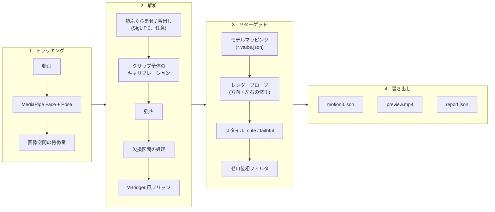

<div align="center">


<p><strong>人物を撮影した動画を、オフラインで Live2D Cubism モーションに変換します。</strong></p>

<p>
<a href="https://github.com/FMsongX2/video2live2d/actions/workflows/ci.yml"></a>
<a href="LICENSE"></a>


</p>

<p><a href="README.md">English</a> · <a href="README.ko.md">한국어</a> · <strong>日本語</strong> · <a href="README.zh-CN.md">简体中文</a></p>

</div>

video2live2d（V2L）は、顔と肩が映った実在の人物の動画を読み込み、VBridger 互換の Live2D モデル用に Cubism `.motion3.json` を書き出します。iPhone もリアルタイムトラッキングも使いません。クリップを録画してコマンドを 1 つ実行すれば、VTube Studio や任意の Cubism ランタイムで再生できるモーションが得られます。製品名は V2L で、Python パッケージとコマンドの名前は `v2l` です。

## 特長

- **動画を入れるとモーションが出てくる。** 普通に録画したクリップから、頭と体の角度、目と視線、眉、VBridger の口パラメータ一式、肩、呼吸を生成します。
- **自動キャリブレーション。** クリップ内で最も動きの少ない区間を基準の表情とし、VBridger の手動 Calibrate ボタンの代わりにします。区間は自分で指定することもできます。
- **モデル自身の設定を利用。** モデルに `*.vtube.json`（VTube Studio の設定）があれば、パラメータ範囲、クランプ、呼吸をそこから取得します。なければ標準の Cubism パラメータ ID を使います。
- **リグに依存しない方向チェック。** ヘッドレスのレンダープローブが各パラメータの画面上の効果を計測し、逆向きの方向や左右が入れ替わった目を修正します。結果はモデルごとにキャッシュされます。
- **SnenkBridge 形式のブリッジ。** 内蔵の VBridger 風ブリッジは SnenkBridge 数式言語の安全なインタプリタで評価され、`--bridge FILE` で同じ形式の他のプリセットを読み込めます。
- **2 つのスタイル。** `cute`（デフォルト）は少し明るく生き生きとした演技を加え、`faithful` は何も加えません。
- **すべて調整可能。** 入力、キャリブレーション、強さ、スムージング、スタイルなど 10 セクション・67 項目の設定は、CLI、V2L Studio、MCP サーバーが共有する 1 つのスキーマから来ています。内蔵プリセットとユーザープリセットでまとめて扱えます。
- **エージェント対応。** `--json` で JSON の結果オブジェクトを 1 つ、`--progress json` で JSON Lines の進捗イベントを出力し、終了コードを明文化し、AI エージェント向けの MCP サーバーも備えています。
- **モーション編集。** 区間ごとにリニア・ベジェ・ステップ・逆ステップを選べるキーフレーム、ベジェハンドル、再フィット、取り消しを、V2L Studio のカーブエディタまたは `v2l motion` の操作で扱えます。
- **3 層のマッピング編集。** VBridger、SnenkBridge、VTube Studio のパラメータ設定を手本にしています。入力カーブ、数式と SnenkBridge 風のディレイバッファ・VBridger 風のモディファイア（遅延、スムージング、ステップ）を持つブリッジ出力、そして範囲、反転、クランプ、応答カーブ、スムージングのカットオフを決めるパラメータごとのマッピングです。
- **オプション: 頬ふくらませと舌出し。** ゼロショットの SigLIP 2 ステージが、MediaPipe がうまく報告できない表情をスコア化します。
- **プレビューとレポート。** 元動画とモデルを並べたプレビュー動画と、検出率・まばたき・レンジ使用率・警告を含む `report.json`。
- **ノート PC + 計算ホストのワークフロー。** 標準ライブラリのみの `bin/v2l-remote` が SSH 経由で別のマシンでパイプラインを実行し、V2L Studio はそれを Live2D ビューアとウェブカメラ録画を備えたデスクトップアプリにまとめます。

## 仕組み



| ステージ | ソース | 内容 |
|---|---|---|
| トラッキング | `src/v2l/signals.py` | MediaPipe Face Landmarker（ARKit 名のブレンドシェイプ 52 個、頭部変換、ランドマーク 478 点）と Pose Landmarker（肩）。 |
| 特徴量 | `src/v2l/features.py` | 頭の yaw/pitch/roll、左右それぞれの目の開き、虹彩による視線、顎の開き、唇内側の隙間、口の幅、顔基準の口の横移動、肩の roll/yaw/高さ。 |
| 頬 / 舌 | `src/v2l/rare.py` | 任意。N フレームごとに SigLIP 2 でゼロショットのスコアを付けます。 |
| キャリブレーション | `src/v2l/calibrate.py` | クリップ全体から基準の表情（最も動きの少ない区間）とチャンネルごとの反応幅を求めます。 |
| 強さ | `src/v2l/calibrate.py` | 動きのグループ（頭、体、視線、眉、笑顔、口、頬/舌）を `intensity.*` の設定に従って拡大縮小します。 |
| 欠損区間 | `src/v2l/temporal.py` | 出力フレームレートにリサンプリングします。0.4 秒（`gaps.max_gap`）以下の欠損は補間し、それより長い欠損は基準姿勢へ緩やかに戻します。 |
| ブリッジ | `src/v2l/bridge.py`, `src/v2l/bridges/default.json` | SnenkBridge 数式言語の安全な AST インタプリタで VBridger 風の出力を計算します。 マッピングファイルで出力を修正・追加でき、ディレイバッファとモディファイアも使えます。 |
| マッピング | `src/v2l/mapping.py`, `src/v2l/model.py` | モデルの VTube Studio パラメータ設定を再利用し、なければ標準の Cubism ID を使います。 マッピングファイル（`--mapping`）でどのエントリも変更・追加できます。 |
| プローブ | `src/v2l/render.py`, `src/v2l/web/` | モデルをヘッドレスで描画し、逆向きの方向と入れ替わった目の左右を修正します。 |
| スタイル | `src/v2l/style.py` | `cute` または `faithful`。 |
| 書き出し | `src/v2l/motion3.py`, `src/v2l/pipeline.py` | パラメータグループごとのゼロ位相 Butterworth フィルタ、各パラメータ範囲の 0.4 % 以内で Ramer-Douglas-Peucker 簡略化した線形セグメント（`output.interpolation=bezier` では制限付きベジェ）、検証、プレビューとレポート。 |
| 設定 | `src/v2l/config.py`, `src/v2l/presets/` | すべてのステージが使う設定スキーマ、検証、プリセット。 |
| 編集 | `src/v2l/motionedit.py`, `src/v2l/inputs.py` | 編集可能なモーション形式、編集操作、フィッティング、検証、マッピングで使える入力の一覧。 |

物理演算の出力パラメータはランタイムに任せます。プローブとプレビューの描画には、Playwright でインストール済みの Google Chrome を SwiftShader（CPU レンダリング）で動かします。GPU の WebGL バックエンドでは非常に大きい（8K）テクスチャでコンテキストが失われたためです。

## 動作要件

**計算ホスト**（`v2l` を実行）

- Linux（x86_64 または arm64）または Apple silicon の macOS、Python 3.11 以上。MediaPipe は Intel macOS 向けの wheel を公開していません。
- Google Chrome がインストールされていること（Playwright が `channel="chrome"` で起動します）。
- ffmpeg を別途用意する必要はありません。`imageio-ffmpeg` にバイナリが含まれています。
- 任意: 頬/舌ステージ用の NVIDIA GPU。空きメモリが 3 GB 以上あれば GPU を使い、なければ CPU で、スコア付けするフレームあたり約 0.8 秒かかります。

**ノート PC**（リモートワークフローと V2L Studio 用）

- V2L Studio: Node.js と npm、そして `python3`。`PATH` 上の `ffmpeg` は任意で、Studio がウェブカメラのテイクを正しくシークできるようリマックスするときに使います。
- リモートモード（`bin/v2l-remote`、Studio の **リモートサーバー**、`bin/v2l-mcp`）: `python3`、`rsync`、計算ホストへ鍵認証でログインできる `ssh`。
- ローカルモード（Studio の **このコンピュータ**）: 上記の計算ホストの要件を同じマシンで満たす必要があります。

計算ホストとノート PC は同じマシンでも構いません。

## クイックスタート

### A. 計算ホストで実行

```bash
git clone https://github.com/FMsongX2/video2live2d.git
cd video2live2d
python3 -m venv .venv && source .venv/bin/activate
pip install -e .
# optional: cheek puff / tongue out (installs torch + transformers)
pip install -e '.[rare]'

v2l run clip.mp4 --model ~/Models/MyModel --name hello
```

結果は `v2l_out/`（`hello.motion3.json`、`hello.preview.mp4`、`hello.report.json`）に保存されます。`--no-install` を指定しない限り、モーションはモデルフォルダにもコピーされます。トラッカーモデルと Live2D Cubism Core は初回使用時にダウンロードされます。

### B. ノート PC + 計算ホスト

```bash
export V2L_HOST=user@gpu-box          # required, no default
export V2L_DIR=v2l                    # optional, relative to the remote home

bin/v2l-remote setup                  # push code, create .venv, install, pre-download tracker models, Cubism Core and renderer libraries
bin/v2l-remote run clip.mp4 --model ~/Models/MyModel --name hello --out ~/Downloads/v2l_out
```

`run` は動画とモデルフォルダをアップロードし、ホストで `v2l run` を実行して、結果を `~/Downloads/v2l_out/hello/` に取り込みます。`--no-install` を指定しない限り、モーションはローカルのモデルフォルダにもコピーされます。その他の `v2l run` オプション（`--preset`、`--config`、`--set`、ショートカットフラグ）も使えます。接続は `bin/v2l-remote check` で確認できます。コードを更新したら `setup` を再実行してください。ホストで頬/舌ステージを有効にするには、ホストの `V2L_DIR` 内で `.venv/bin/pip install -e '.[rare]'` を実行します。

### C. V2L Studio

```bash
bin/v2l-studio
# optional: values from the environment (shown locked in Settings)
V2L_MODEL=~/Models/MyModel V2L_HOST=user@gpu-box bin/v2l-studio
```

初回起動時に `app/` で `npm install` を実行します。モーションの生成には計算環境が必要で、**設定 → 計算**で選びます。

- **リモートホスト:** `user@gpu-box` を入力して **接続をテスト** を押し、続けて **サーバーを設定** を押します（`bin/v2l-remote setup` を実行）。
- **このコンピュータ:** **このコンピュータを設定** を押す（リポジトリに `.venv` を作成して V2L をインストール）か、A のように `.venv` 内で `pip install -e .` を実行して自分でインストールします。

`V2L_HOST` や `V2L_MODEL` などの環境変数も引き続き使え、対応する設定をロックします。

## 使い方リファレンス

### `v2l run`

```text
v2l run VIDEO --model DIR --name NAME [--out DIR] [--preset NAME|FILE] [--config FILE]...
        [--set SECTION.NAME=VALUE]... [shortcut flags] [--mapping FILE] [--dump-signals]
        [--no-install] [--dry-run] [--json] [--progress text|json]
```

設定は次の順に適用され、後のものが優先されます。

**デフォルト < `--preset` < `--config` ファイル（指定順） < ショートカットフラグ < `--set`（指定順）**

<details>
<summary>すべてのオプション</summary>

| オプション | デフォルト | 意味 |
|---|---|---|
| `--model DIR` | 必須 | Live2D モデルフォルダ（`*.model3.json`、任意で `*.vtube.json`）。 |
| `--name NAME` | 必須 | 出力名。モーションは `NAME.motion3.json` になります。 |
| `--out DIR` | `v2l_out` | 出力フォルダ。ファイルはこのフォルダに直接書き出されます。 |
| `--preset NAME\|FILE` | なし | 内蔵プリセット、ユーザープリセット、またはプリセットファイル（[設定とプリセット](#設定とプリセット)を参照）。 |
| `--config FILE` | なし | JSON の設定ファイル。複数指定でき、後のファイルが優先されます。 |
| `--set SECTION.NAME=VALUE` | なし | 設定 1 つ。例: `intensity.smile=1.5`、`calibration.neutral_window=2:3`。複数指定でき、最後に適用されます。 |
| `--mapping FILE` | なし | マッピングファイル（[モーションとマッピングの編集](#モーションとマッピングの編集)を参照）。 |
| `--dump-signals` | オフ | `NAME.signals.json` も書き出します。フレームごとのトラッキング入力とブリッジ出力です。 |
| `--no-install` | オフ | モーションをモデルフォルダにコピーしません。 |
| `--dry-run` | オフ | 入力と設定をチェックし、予定の出力ファイルと最終的な設定を表示します。トラッキングは行いません。 |
| `--json` | オフ | stdout には JSON の結果オブジェクトを 1 つだけ出力し、それ以外はすべて stderr に送ります。 |
| `--progress text\|json` | `text` | `json`: stderr のすべての行が JSON イベントになります（下記参照）。 |

</details>

<details>
<summary>ショートカットフラグ（それぞれ設定 1 つを指定）</summary>

| フラグ | 設定 | 意味 |
|---|---|---|
| `--style cute\|faithful` | `style.name` | `cute`（デフォルト）は少し明るい基準表情、笑顔に合わせた目の笑みと頬染め、やや大きめの平常時の目、少し多めの頭の動きを加え、モデルに `ParamEyeSparkle` があれば長く大きな笑顔でキラキラした目にします。`faithful` は何も加えません。 |
| `--fps N` | `output.fps` | 出力フレームレート（デフォルト 30）。 |
| `--fade S` | `output.fade` | フェードイン/アウトの時間（秒、デフォルト 0.5）。 |
| `--loop` | `output.loop=true` | モーションを継ぎ目なくループさせます（待機アニメーション向け）。 |
| `--flip` | `input.flip=true` | 入力が左右反転で録画されています（自撮りカメラ）。 |
| `--start S`, `--end S` | `input.start`, `input.end` | クリップの一部だけを使います（秒）。 |
| `--neutral A:B` | `calibration.neutral_window` | 基準表情の区間（秒）。`--start` からの相対時間です。デフォルト: 自動検出。 |
| `--bridge NAME\|FILE` | `bridge.preset` | 内蔵ブリッジのプリセット名（デフォルト `default`）、または SnenkBridge 形式の JSON ファイル。パラメータの一覧そのものか `snek` プリセットで、`delayBuffer` の出力にも対応します。 |
| `--no-preview` | `preview.enabled=false` | プレビュー動画を作りません。 |
| `--no-rare` | `expressions.enabled=false` | 頬ふくらませ / 舌出しステージを省略します。 |
| `--rare-stride N` | `expressions.stride` | N フレームごとに頬ふくらませ / 舌出しをスコア付けします（デフォルト 3）。 |

</details>

**カーブの補間。** `output.interpolation` のデフォルトは `linear` です。`--set output.interpolation=bezier` は制限付きベジェのセグメントを書き出します。キーはおよそ半分になり編集しやすくなりますが、ベジェセグメントは 1 つで 3 点と数えられるため、ファイルは大きくなります。

**JSON の結果**（`--json`）:

```text
{"ok": true, "name": "hello", "out_dir": "...", "files": {"motion": "...", "report": "...", "preview": "..." | null},
 "installed": "..." | null, "summary": {...}}
{"ok": false, "error": {"type": "...", "message": "..."}}
```

`--dry-run` の場合、結果には `"summary"` の代わりに `"dry_run": true` と `"settings"` が入ります。

**進捗イベント**（`--progress json`、stderr の 1 行に JSON オブジェクト 1 つ）:

| イベント | フィールド |
|---|---|
| `stage` | `stage`: `probe`、`tracking`、`expressions`、`solving`、`writing`、`preview` のいずれか（`v2l-remote` は先頭に `upload`、末尾に `download` を追加します）。 |
| `progress` | `stage`、`done`、`total`。約 0.5 秒ごと、最後の値は必ず送られます。 |
| `log` | `message`。トラッカーやライブラリの出力もこのイベントに包まれます。 |

**終了コード**（`v2l` と `v2l-remote` で共通）:

| コード | エラー種別 |
|---|---|
| `0` | 成功 |
| `1` | `runtime`, `remote` |
| `2` | `usage`, `config`, `input`, `invalid`（検証に通らないモーション、編集操作、マッピング、数式） |
| `3` | `unusable_input`: 動画が開けない、または顔がトラッキングされない |
| `4` | `remote_unreachable`: 計算ホストに接続できない |
| `130` | `interrupted`, `cancelled` |

### その他の `v2l` コマンド

| コマンド | 内容 |
|---|---|
| `v2l probe --model DIR [--details] [--json]` | モデルのパラメータ範囲を読み取り、画面上の方向を計測します（モデルごとにキャッシュ）。`--details` はプローブしたすべてのパラメータの計測結果を追加します。 |
| `v2l presets list [--json]` | 内蔵プリセットとユーザープリセットの一覧。 |
| `v2l presets show NAME\|FILE` | プリセットの設定を JSON で表示します。 |
| `v2l presets save NAME FILE` | `FILE` を検証し、ユーザープリセット `NAME` として保存します。 |
| `v2l config schema` | すべての設定の型、デフォルト、範囲、単位、ヘルプ、`affects` を JSON で出力します。 |
| `v2l config defaults` | デフォルト設定を JSON で出力します。 |
| `v2l config presets` | 内蔵プリセットとユーザープリセットを JSON で出力します。 |
| `v2l config validate FILE...` | 設定ファイルをチェックし、マージ結果を表示します。 |
| `v2l version [--json]` | V2L のバージョン。 |
| `v2l motion info\|read\|write\|edit\|refit\|eval\|validate ...` | モーションファイルの確認、変換、編集、再フィット、サンプリング、検証。 |
| `v2l mapping show\|inputs\|validate ...` | 各値の出どころを含むモデルの最終的なマッピング、マッピングで使える入力、マッピングファイルの検証。 |
| `v2l bridge show\|check\|validate ...` | 最終的なブリッジ出力、数式 1 つのチェック、SnenkBridge プリセットまたはマッピングの bridge セクションの検証。 |
| `v2l mcp [...]` | MCP サーバー（[エージェント](#エージェント-mcp--cli)を参照）。 |

`v2l config`、`v2l presets`、`v2l version`、`v2l motion`、`v2l bridge`、そして `--model` なしの `v2l mapping inputs|validate` は標準ライブラリだけで動きます。形式とすべてのオプション: [docs/motion-editing.md](docs/motion-editing.md)。

### `bin/v2l-remote`

| コマンド | 内容 |
|---|---|
| `setup` | `V2L_HOST` にコードを送り、`.venv` を作成して `pip install -e '.[test]'` を実行し、トラッカーモデル、Cubism Core、レンダラーライブラリを事前にダウンロードします。 |
| `run VIDEO --model DIR --name NAME [--out DIR] [--no-install] [--json] [--progress text\|json] [v2l run options...]` | ホストで `v2l run` を実行し、結果を `OUT/NAME/` に取り込みます（`--out` のデフォルトは `V2L_OUT`、未設定なら `~/Downloads/v2l_out`）。 |
| `probe --model DIR [--details] [--json]` | ローカルのモデルをホストでプローブします。 |
| `mapping show --model DIR [--mapping FILE] [--json]` | ローカルのモデルの最終的なマッピングをホストで計算します。 |
| `mapping inputs\|validate ...`、`bridge ...` | ノート PC で実行し、`V2L_HOST` は不要です。 |
| `check [--json]` | ホストに接続できるか、V2L がインストールされているかを確認します。 |
| `version [--json]` | ローカルの V2L コードのバージョン。 |
| `test` | ホストでユニットテストを実行します。 |
| `regress` | `V2L_REGRESS_MODEL` のモデルを使い、ホストで回帰ハーネスを実行します。 |

`v2l-remote run` における設定とジョブの扱い:

- `--preset`、`--config` ファイル、ショートカットフラグ、`--set` は**ノート PC 側で**解決されるため、ユーザープリセットやローカルファイルがそのまま使われます。実行ごとに最終的な設定を収めたファイルを 1 つ（ローカルのブリッジファイルがあればそれも）アップロードし、終了後に削除します。不正な設定はアップロード前にエラーになります。
- `--dry-run` は接続せずにノート PC 上で実行されます。
- `--mapping FILE` は設定ファイルと同様にアップロードされ、実行後に削除されます。`--dump-signals` を指定すると、シグナルファイルも結果と一緒に戻ってきます。
- `v2l-remote` を止める（Ctrl-C、SIGTERM、SIGHUP）とホスト上のジョブも止まり、その実行のファイルが削除され、終了コード 130 で終了します。

### 環境変数

| 変数 | 使用箇所 | 意味 |
|---|---|---|
| `V2L_HOST` | `v2l-remote`、Studio、MCP サーバー | 計算ホストの SSH 接続先（例: `user@gpu-box`）。`v2l-remote` では必須で、デフォルトはありません。MCP サーバーではリモートモードを有効にします。 |
| `V2L_DIR` | `v2l-remote`、Studio、MCP サーバー（リモートモード） | ホスト上の作業ディレクトリ。デフォルトは `v2l`（リモートのホームからの相対パス）。 |
| `V2L_OUT` | `v2l-remote`、Studio、MCP サーバー | 出力フォルダ（`v2l-remote run --out` のデフォルト）。デフォルトは `~/Downloads/v2l_out`。 |
| `V2L_MODEL` | Studio | 起動時に開くモデルフォルダ。任意。 |
| `V2L_CUBISM_CORE` | `v2l` | ダウンロードの代わりに使うローカルの `live2dcubismcore.min.js` のパス。 |
| `V2L_REGRESS_MODEL` | `v2l-remote regress` | 回帰実行に使うモデルフォルダ。`regress` では必須。 |
| `XDG_CONFIG_HOME` | `v2l`、`v2l-remote`、MCP サーバー | ユーザープリセットは `$XDG_CONFIG_HOME/v2l/presets`（デフォルト `~/.config/v2l/presets`）に置かれます。 |

## 設定とプリセット

調整できる値はすべて 1 つのスキーマ `src/v2l/config.py` にまとまっています。10 セクション、67 項目です。CLI、V2L Studio、MCP サーバーが同じスキーマを読むため、設定の名前、範囲、意味はどこでも同じです。未知のキー、誤った型、範囲外の値はエラーになります。

| セクション | 対象 | キーの例 |
|---|---|---|
| `input` | 動画のどの部分をどう読むか。 | `start`, `end`, `flip` |
| `output` | モーションのフレームレート、フェード、ループ、ファイルサイズ。 | `fps`, `loop`, `interpolation` |
| `calibration` | 基準表情と各表情の最大幅の推定方法。 | `neutral_window`, `jaw_full`, `gaze_full` |
| `intensity` | 動きのグループごとの全体的な強さ。 | `head`, `smile`, `mouth_open` |
| `gaps` | 顔を一時的に見失ったときの処理。 | `max_gap`, `ramp` |
| `expressions` | 任意の頬ふくらませ / 舌出しステージ。 | `enabled`, `stride`, `cheek_thresholds` |
| `bridge` | トラッキング入力からブリッジ出力への VBridger 風の数式。 | `preset` |
| `style` | トラッキングした動きに加える演技スタイル。 | `name`, `blush_smile`, `head_gain` |
| `filtering` | パラメータグループごとのゼロ位相ローパスフィルタ。 | `cutoff_scale`, `head`, `mouth` |
| `preview` | 並べて表示するプレビュー動画。 | `enabled`, `width`, `height` |

<details>
<summary>セクションごとの全設定名</summary>

| セクション | 設定 |
|---|---|
| `input` | `start`, `end`, `flip`, `analysis_width` |
| `output` | `fps`, `fade`, `loop`, `loop_blend`, `breath_period`, `interpolation`, `tolerance` |
| `calibration` | `neutral_window`, `neutral_seconds`, `rest_head_range`, `full_percentile`, `min_span`, `max_gain`, `blink_deadzone`, `blink_landmark_weight`, `eye_closed_ratio`, `eye_wide_range`, `jaw_full`, `lip_gap_full`, `mouth_narrow_full`, `mouth_wide_full`, `mouth_shift_full`, `gaze_full` |
| `intensity` | `head`, `body`, `gaze`, `brows`, `smile`, `mouth_open`, `mouth_shape`, `cheek_tongue` |
| `gaps` | `max_gap`, `ramp` |
| `expressions` | `enabled`, `stride`, `cheek_thresholds`, `tongue_thresholds` |
| `bridge` | `preset` |
| `style` | `name`, `mouth_form_bias`, `eye_smile_max`, `blush_rest`, `blush_smile`, `eye_open_scale`, `head_gain`, `sparkle_param`, `sparkle_smile`, `sparkle_hold` |
| `filtering` | `despike`, `cutoff_scale`, `head`, `body`, `eyeball`, `eye_open`, `brows`, `smile`, `mouth`, `blush`, `sparkle`, `other` |
| `preview` | `enabled`, `width`, `height` |

</details>

型、デフォルト、範囲、単位、ヘルプは `v2l config schema`（または標準ライブラリだけで動く `python -m v2l.config schema`）で確認できます。

**変更の影響範囲。** 各設定には `affects` の値があります。

- `tracking`: 動画を再トラッキングします（`input.*`、`expressions.enabled`、`expressions.stride`）。
- `solve`: キャッシュ済みのトラッキング結果を再利用し、モーションだけを再計算します（ほとんどの設定）。トラッキングのキャッシュは `v2l` を実行するマシンの `~/.cache/v2l` にあるため、同じクリップを solve 設定だけ変えて再実行するとトラッキングは省略されます。
- `output`: プレビューの描画だけが変わります（`preview.*`）。

**内蔵プリセット**

| プリセット | 説明 |
|---|---|
| `default` | V2L のデフォルト: cute スタイル、基準表情の自動検出、標準のスムージング。 |
| `faithful` | カメラに映ったものだけ: 笑顔、頬染め、目、頭のスタイリングを加えません。 |
| `calm` | 話す、朗読、ASMR 風のクリップ向けに、頭と体の動きを小さく滑らかに。 |
| `lively` | 元気なクリップ向けに、頭、体、顔の動きを大きく。 |
| `idle_loop` | 継ぎ目のない待機アニメーション: ループ、呼吸の周期を揃え、穏やかなスムージング。 |

ユーザープリセットは `$XDG_CONFIG_HOME/v2l/presets`（デフォルト `~/.config/v2l/presets`）に置きます。内蔵プリセットと同じ名前のユーザープリセットは内蔵のものを置き換えます。プリセットは、任意の `meta` ブロックを持つ設定ファイルです。

```json
{
  "version": 1,
  "meta": {"name": "Talk show", "description": "Calmer head, stronger smile."},
  "intensity": {"head": 0.8, "smile": 1.3},
  "filtering": {"cutoff_scale": 0.8}
}
```

```bash
v2l config validate talk_show.json
v2l presets save talk_show talk_show.json
v2l run clip.mp4 --model ~/Models/MyModel --name hello --preset talk_show --set intensity.smile=1.5
```

## モーションとマッピングの編集

モーションとマッピングは、生成後も CLI、MCP サーバー、V2L Studio から編集できます。ファイル形式、すべての操作、数式の文法、すべてのコマンドオプションは、完全な仕様である [docs/motion-editing.md](docs/motion-editing.md) にあります。

### モーション

モーションは通常の `.motion3.json` ファイルです。2 つのキーの間の各区間は、リニア、ベジェ、ステップ、逆ステップのいずれかです。V2L は**制限付きベジェ**（`AreBeziersRestricted`）を書き出します。2 つの制御点が区間の時間の 1/3 と 2/3 の位置にあるため、値は時間の 3 次多項式になり、どの Cubism ランタイムでも同じように評価されます。エディタが変えるのは制御値だけです。ほかのツールのベジェは正確に読み込み、その区間を編集したときだけ変換します。

`v2l motion read` は編集可能な JSON（キー、区間ごとの種類、ハンドル）を返します。`v2l motion edit` は操作の一覧を順に適用します: キーの追加・移動・削除、補間とハンドルの設定、自動・フラットの接線、再フィット、拡大縮小、オフセット、クランプ、時間調整、トリミング、タイミング。不正な操作はその番号とともに報告され、何も書き込まれません。既存の出力ファイルは `--overwrite` があるときだけ置き換えます。

```json
[
  {"op": "insert_key", "curve": "ParamAngleX", "t": 1.0, "value": 12},
  {"op": "set_interpolation", "curves": ["ParamAngleX"], "type": "bezier", "from": 0.5, "to": 2.0},
  {"op": "refit", "curves": "*", "tolerance": 0.004, "interpolation": "bezier"},
  {"op": "trim", "from": 1.0, "to": 13.0}
]
```

```bash
v2l motion read hello.motion3.json --json                # editable JSON: keys, segment types, handles
v2l motion edit hello.motion3.json --ops ops.json --out hello_edit.motion3.json --json
v2l motion refit hello.motion3.json --interpolation bezier --tolerance 0.004 --out hello_bezier.motion3.json
```

### マッピング

マッピングファイル（`--mapping FILE`）は、モデルごとに、トラッキングが Live2D パラメータへ届く方法を変えます。3 層からなり、トラッキングの後にこの順で適用されます。

| 層 | 手本 | 変えるもの |
|---|---|---|
| `input_curves` | VBridger の入力カーブ | トラッキング入力の形を変えます。例: 開き切らない目でも 1 に届くようにする。 |
| `bridge` | SnenkBridge のプリセット、VBridger のモディファイア | ブリッジ出力の修正・追加・無効化: 数式、SnenkBridge 風の `delayBuffer`、モディファイア `delayMs`、`smoothing`、`steps`。 |
| `entries` | VTube Studio のパラメータ設定 | Live2D パラメータごとに、入力、入力と出力の範囲、反転、クランプ、応答カーブ、スムージングのカットオフ、呼吸、オン/オフ。 |

```json
{
  "format": "v2l.mapping",
  "version": 1,
  "input_curves": {"EyeWideLeft": {"points": [[0, 0], [0.6, 1], [1, 1]], "smooth": true}},
  "bridge": [
    {"name": "MouthOpen", "modifiers": {"smoothing": 0.2}},
    {"name": "EarSwing", "func": "", "min": -1, "max": 1, "defaultValue": 0,
     "delayBuffer": {"refParam": "FaceAngleX", "smoothing": 3, "delayCount": 8,
                     "inMin": -20, "inMax": 20, "outMin": -1, "outMax": 1}}
  ],
  "entries": [
    {"output": "ParamAngleX", "in": [-25, 25], "out": [-30, 30], "cutoff": 2.0},
    {"output": "ParamEarL", "input": "EarSwing"},
    {"output": "ParamBodyAngleZ", "enabled": false}
  ]
}
```

```bash
v2l mapping inputs --json                               # input names, meaning, nominal range
v2l mapping show --model ~/Models/MyModel --mapping MyModel.json
v2l bridge check --func "0.5 + 0.5 * (MouthSmileLeft + MouthSmileRight)"
v2l run clip.mp4 --model ~/Models/MyModel --name hello --mapping MyModel.json --dump-signals
```

保存されるのは変更した値だけで、それ以外はレンダープローブの向きの修正を経たモデルの `*.vtube.json` か標準のマッピングから取られます。数式は SnenkBridge の文法に従い、違いは仕様にまとめてあります。3 層はトラッキングの後に適用されるため、マッピングを変えてもトラッキングのキャッシュが再利用されます。`--dump-signals` はフレームごとの入力とブリッジ出力を収めた `NAME.signals.json` を書き出し、マッピングが見ている値をグラフにできます。

### V2L Studio で

モーションエディタとマッピングエディタ（[V2L Studio](#v2l-studio) を参照）は同じ形式を扱い、同じ操作を呼び出します。

<p align="center"></p>

<p align="center">


</p>

## エージェント (MCP & CLI)

AI エージェントは 2 通りの方法で V2L を操作できます。`--json` と `--progress json` を使う CLI と、stdio で動く [MCP](https://modelcontextprotocol.io/) サーバーです。すでにシェルコマンドを実行できるコーディングエージェントには CLI の方が軽量です。MCP サーバーはチャットやデスクトップのクライアントに向いています。

**インストール**

- ローカルモード（このマシンでトラッキング）: `pip install -e '.[mcp]'` のあと `v2l mcp` を実行します。
- リモートモード（ノート PC で動かし、ジョブは `v2l-remote` 経由で `V2L_HOST` 上で実行）: `bin/v2l-mcp` を使います。必要なのは `python3`、`rsync`、`ssh` と `mcp` パッケージだけで、`mcp` がなければ [uv](https://docs.astral.sh/uv/) が用意します。

`V2L_HOST` が設定されていれば、サーバーは常にリモートモードで動きます。

**クライアントへの登録**（`/abs/path` と `user@gpu-box` はご自身の値に置き換えてください）:

```bash
# local mode
claude mcp add v2l -- /abs/path/video2live2d/.venv/bin/v2l mcp
# remote mode
claude mcp add v2l -e V2L_HOST=user@gpu-box -e V2L_DIR=v2l -- /abs/path/video2live2d/bin/v2l-mcp
codex mcp add v2l --env V2L_HOST=user@gpu-box --env V2L_DIR=v2l -- /abs/path/video2live2d/bin/v2l-mcp
```

JSON で設定するクライアントの場合:

```json
{
  "mcpServers": {
    "v2l": {
      "command": "/abs/path/video2live2d/bin/v2l-mcp",
      "env": {"V2L_HOST": "user@gpu-box", "V2L_DIR": "v2l", "V2L_OUT": "/Users/me/Downloads/v2l_out"}
    }
  }
}
```

**ツール**

| ツール | 内容 |
|---|---|
| `v2l_params(section?)` | 設定スキーマ、デフォルト、プリセット。セクションを 1 つに絞ることもできます。 |
| `v2l_validate_settings(settings?, preset?)` | 設定だけのドライラン: プリセットと部分的な設定を適用してチェックします。 |
| `v2l_probe_model(model, details?)` | モデルのパラメータと画面上の方向をプローブします。 |
| `v2l_list_motions(model)` | モデルフォルダ内の `*.motion3.json` ファイル。 |
| `v2l_mapping_get(model, mapping?)` | モデルの最終的なマッピング（3 層すべて）と使える入力。 |
| `v2l_bridge_check(func, mapping?)` | ブリッジの数式を 1 つチェックします: 読む名前、不明な名前、エラー位置。 |
| `v2l_motion_info(motion)` | モーションのカーブ、セグメントの種類、数、問題点。 |
| `v2l_motion_read(motion, curves?)` | モーションを編集可能な JSON として返します。 |
| `v2l_motion_edit(motion, operations, out, overwrite?, ranges?)` | 編集操作を適用し、結果を新しいモーションとして書き出します。 |
| `v2l_generate(video, model, name, preset?, settings?, mapping?, preview?, out_dir?, install?, job?, wait_seconds?)` | 生成ジョブを開始または再開します。 |
| `v2l_job_status(job, wait_seconds?)` | ジョブを待ち、進捗または結果を返します。 |
| `v2l_jobs()` | 既知のすべてのジョブ。 |
| `v2l_job_cancel(job)` | 待機中または実行中のジョブを止めます（リモートモードではホスト上のプロセスも）。 |
| `v2l_install_motion(motion, model, overwrite?)` | モーションをモデルフォルダにコピーします（`install` ツールセットのみ）。 |

**長いジョブ。** `v2l_generate` は進捗通知を送りながら最大 45 秒（デフォルト 40 秒。一般的なクライアントの 60 秒のリクエストタイムアウトより短い）待ち、結果かジョブハンドルを返します。ハンドルを渡して `v2l_job_status` を呼べば待ち続けられます。同じリクエスト（同じ動画とモデルの内容、設定、名前、出力フォルダ）をもう一度送ると、2 回目の実行は始まらず同じジョブが再開されます。ジョブは 1 つずつ実行され、後のジョブは `queued` になります。ジョブの記録は `~/.cache/v2l/jobs/` に保存されます。

**サーバーのフラグ**

| フラグ | 意味 |
|---|---|
| `--read-only` | モーションの生成、取り消し、インストールを行うツールを隠します。 |
| `--toolsets inspect,generate,install` | 有効にするツールグループ（デフォルト `inspect,generate`）。 |
| `--allow-dir DIR` | すべてのパス引数がこれらのフォルダのいずれかの中になければなりません（複数指定可）。出力フォルダは出力用に常に許可されます。 |

**安全性**

- 計算ホストはツールの引数ではなく、`V2L_HOST` / `V2L_DIR` からのみ決まります。
- パスは絶対パスか `~` で始まる必要があり、名前は `^[A-Za-z0-9_-]{1,80}$` に一致する必要があります。
- モデルフォルダへのインストールはデフォルトでオフです。`install` ツールセットを有効にしない限り `install=true` は拒否されます。
- 既存の `<out>/<name>/` は決して上書きされません。失敗または取り消されたジョブは自分の出力フォルダを削除するため、再試行で同じ名前を使えます。
- `v2l_motion_edit` は出力フォルダか `--allow-dir` のフォルダの中にだけ書き込み、モデルフォルダへは `install` ツールセットがある場合のみ書き込みます。`--read-only` では隠されます。

**GUI クライアントと `PATH`。** デスクトップアプリは最小限の `PATH` で起動することが多く、`v2l`、`uv`、`rsync`、`ssh` が見つからない場合があります。クライアントの設定には絶対パスを使い、`bin/v2l-mcp` が必要とするツールが標準的な場所にあることを確認してください。ターミナルから起動すると、サーバーは MCP クライアントを待っている旨を表示します。ハングではありません。

## V2L Studio

<p align="center">


</p>

V2L Studio（`bin/v2l-studio`）は、片側に Live2D ビューア、もう片側に作成パネルを備えた Electron デスクトップアプリです。

- **ビューア。** フレーミングのプリセット、ドラッグとズーム、物理演算の切り替え、スクラブバー。**Space** で再生を切り替えます。テクスチャは 4K に制限した表示用コピーで表示し、モデルフォルダは変更しません。
- **作成パネル。** 動画を選ぶかドロップするか、ウェブカメラでテイクを録画します。モーション名、チューニングプリセット、スタイルを設定し、必要に応じてトリミング、基準表情の区間、頬/舌の認識、左右反転を指定します。⋯ メニューから、これらをデフォルトとして保存、リセット、または実行内容を `v2l run` コマンドとしてコピーできます。
- **生成。** 番号付きのステージ一覧（upload、probe、tracking、expressions、solving、writing、preview、download）と、トラッキングと表情スコア付けのフレーム進捗を表示し、生のログも確認できます。失敗は原因ごとに表示され（使える顔がない、ホストに接続できない、設定が不正、取り消し）、取り消し時には確認があります。完了した結果は、元動画と同期して比較する、モデルフォルダに保存する（上書き前に確認）、**この設定を使用** で設定を読み込み直す、**現在の設定で再実行** で番号付きの名前で再生成する、といった操作ができます。
- **モーションエディタ。** **モーションを編集**（モーション一覧の横、または結果にあります）で、ビューアの下にカーブエディタが開き、ビューアと元動画が再生ヘッドに追従します。キーの選択・ドラッグ・追加、ベジェハンドルの編集、区間のリニア・ベジェ・ステップ・逆ステップの切り替え、自動・フラットの接線、インスペクタでの再フィット・拡大縮小・トリミング・時間調整ができます。すべての変更は取り消しとやり直しに対応し、ポップオーバーにキーボードとマウスのショートカットがまとめてあります。新しいモーションとして保存、確認のうえ上書き保存、またはモデルフォルダに保存します。
- **マッピングエディタ。** モデルヘッダーの **マッピング**、または設定 → 生成のデフォルトの **パラメータのマッピング** で、3 層がタブ（入力、ブリッジ出力、パラメータ）として開きます。**変更をプレビュー** は保存前のマッピングで直前の結果をトラッキングを再利用して作り直して再生し、**残す** か **破棄** でその結果を残すかを決めます。保存したマッピングは以降のすべての実行に渡されます。
- **ウェブカメラのテイク。** 3-2-1 のカウントダウンと無表情の合図があり、その区間が基準表情の区間になります。テイクの長さは 2.3〜60 秒で、マイクはオプトインです。テイクは `<V2L_OUT>/recordings/` に保存されます。
- **言語とテーマ。** 英語、韓国語、日本語、簡体字中国語と、システム・ライト・ダークのテーマ。ニュートラルな色は Adobe Spectrum 2 から取り、アクセントカラーはライトテーマでコーラル（`#FD7688`）、ダークテーマで Spectrum のマゼンタです。

### 設定ウィンドウ

歯車ボタン、アプリのメニュー、または ⌘,（Linux では Ctrl+,）で開きます。検索欄では、ラベル、ヘルプ、キーですべての設定を絞り込めます。

| セクション | 内容 |
|---|---|
| 一般 | 言語、テーマ（システム / ライト / ダーク）、デフォルトのモデルフォルダ、起動時に前回のモデルを開く。 |
| 計算 | **リモートサーバー**（ホスト、リモートディレクトリ、**接続をテスト**、**サーバーを設定**）または **このコンピュータ**（`v2l` 実行ファイルのパス、**テスト**、**このコンピュータを設定**）。 |
| 出力 | 出力フォルダ、同じ結果名があるときの扱い、モデルフォルダへの自動保存（デフォルトはオフ）、プレビュー動画（Studio ではデフォルトでオフ）。 |
| 生成のデフォルト | デフォルトのプリセット、スタイル、ループ、左右反転、頬/舌と間隔、フレームレート、フェード、ブリッジプリセット、カーブの補間、パラメータのマッピング。 |
| チューニング | スキーマのすべての設定を [設定とプリセット](#設定とプリセット) と同じグループで表示します。詳細項目はトグルの後ろにあり、項目とグループごとにリセットでき、トラッキングを変える項目には「動画を再トラッキング」のバッジが付きます。 |
| プリセット | CLI と共有する内蔵プリセットとユーザープリセット: 適用、現在のチューニングを保存、名前変更、削除、インポート、エクスポート。 |
| ビューア | 物理演算、4K テクスチャ、フレーミング、ループ、同期のデフォルト。 |
| カメラ | デフォルトのカメラと音声を録音するかどうか。 |
| エージェントと CLI | コピーできる `claude mcp add` と `codex mcp add` のコマンド、MCP サーバー用のクライアント JSON、そして現在の設定を 1 つにまとめた `v2l run` コマンド。実行ファイル、ホスト、出力フォルダが入力済みです。 |
| 詳細 | ログのフィルタ、モデルキャッシュの削除、全設定のエクスポートとインポート、すべてリセット。 |
| 情報 | バージョン、ライセンス、サードパーティの告知、パスやホスト名を含まない診断情報のコピー。 |

<p align="center"></p>

**保存。** 変更はアプリのデータフォルダ（`v2l-studio`）の `settings.json` に即座に保存され、デフォルトと異なる値だけが記録されます。優先順位: スキーマのデフォルト < Studio の設定 < 環境変数 < 作成パネルの実行ごとの値。環境変数（`V2L_HOST`、`V2L_DIR`、`V2L_OUT`、`V2L_MODEL`）で決まった値はロックされた状態で表示されます。

**実行場所。** ビューア、録画、ファイル処理はノート PC で実行されます。トラッキング・解析・プローブは、設定 → 計算で選んだとおり、リモートホスト（`bin/v2l-remote` 経由）またはこのコンピュータ（ローカルの `v2l` 経由）で実行されます。計算環境を設定するまでは接続ボタンが **生成を設定** と表示され、押すと設定 → 計算が開きます。

## 出力ファイル

`--name hello` の場合、`v2l run` は次のファイルを `--out` フォルダ（デフォルト `v2l_out/`）に直接書き出し、`bin/v2l-remote run` と Studio は `<out>/hello/`（デフォルト `~/Downloads/v2l_out/hello/`）に書き出します。

| ファイル | 内容 |
|---|---|
| `hello.motion3.json` | Cubism モーション。デフォルトは線形セグメント（`output.interpolation=bezier` では制限付きベジェ）で、簡略化と検証を済ませています。 |
| `hello.preview.mp4` | 元動画と、物理演算をオンにしたモデルの描画を並べたもの（`--no-preview` で省略）。 |
| `hello.report.json` | 顔とポーズの検出率、最長のトラッキング欠損、使用した基準表情の区間、まばたき、パラメータごとのレンジ使用率、最終的なマッピング、マッピングのメモ、警告。 |
| `hello.signals.json` | フレームごとのトラッキング入力とブリッジ出力（`--dump-signals` のときのみ）。 |

デフォルトではモーションはモデルフォルダにもコピーされ、VTube Studio がそのモデルのアニメーションとして一覧に表示します。

## 撮影のコツ

- 顔を明るく、すべて見えるようにし、肩まで画面に入れてください。
- 冒頭で約 1 秒間無表情を保ち、`--neutral 0:1` を指定してください。
- 少し大げさに演技してください。アバターはカメラに映ったものしか表現できません。
- 左右反転で録画された映像（自撮りカメラ）には `--flip` を指定してください。
- `--start` と `--end` で、テイクの前後の準備時間を切り落としてください。

## 制限事項

- V2L は iPhone ARKit や VBridger を数値的に再現するものではありません。キャリブレーションは動画から推定しており、互換のブリッジプリセットを使っても出力は VBridger と同等にはなりません。
- MediaPipe のブレンドシェイプには弱い、またはノイズの多いチャンネルがあります。V2L はランドマークの幾何情報と組み合わせていますが、口や眉の細かい形は過小または過大に推定されることがあります。
- 頬ふくらませと舌出しは実験的な機能です。配布していない小規模な社内セット（アノテーション付きクリップ 10 本）でのみ計測しました（フレーム AUC は頬ふくらませ 0.98、舌出し 0.996、MediaPipe の `cheekPuff` は 0.07）。
- 腕と手はリグが動かす場合にのみ、主に物理演算を通じて動きます。演者の腕のポーズは再現しません。
- オフライン専用です。リアルタイムトラッキングのモードはありません。
- 1 クリップにつき演者は 1 人です。
- マッピングファイルで追加したパラメータはレンダープローブで計測されないため、向きは自動では修正されません。

## 開発

```bash
pip install -e '.[test,mcp]'
pytest
```

テストはキャリブレーション、ブリッジ言語、マッピング、欠損区間、motion3 の書き出し、CLI、MCP サーバーを対象としています。MCP のテストは偽の CLI を使い、ネットワークは使いません。`mcp` extra がない場合、MCP SDK を必要とするテストはスキップされます。

**回帰ハーネス。** `regression/run.py` は自分で用意したクリップでパイプラインを実行し、`regression/results/summary.json` とクリップごとのコンタクトシートを書き出します。クリップは配布していません。`regression/videos/manifest.json` に次のように列挙します。

```json
[
  {"id": "talk_front", "file": "talk_front.mp4", "conditions": ["frontal", "speech"]},
  {"id": "turn_dim", "file": "turn_dim.mp4", "conditions": ["head turn", "low light"]}
]
```

`file` は `regression/videos/` からの相対パスです。実行方法:

```bash
python regression/run.py --model /path/to/model [--style cute] [--config FILE]
# or from the laptop:
V2L_REGRESS_MODEL=/path/to/model bin/v2l-remote regress
```

**研究。** `research/rare_expr.py` は、`regression/expressions/manifest.json` に列挙した自分でアノテーションしたクリップで、頬ふくらませ / 舌出しの計測を再現します。

**CI。** [CI ワークフロー](.github/workflows/ci.yml) は `.[test,mcp]` をインストールし、Python 3.12 で `pytest` を実行して、JavaScript の構文をチェックします。

計算ホストとしては Ubuntu 24.04 x86_64 + Python 3.12（頬/舌ステージは GPU と CPU の両方）で、ローカルの `v2l run` と Studio は macOS（Apple silicon）+ Python 3.14 でテストしています。

## サードパーティ製コンポーネントとライセンス

V2L 自体のコードは MIT ライセンスです（[LICENSE](LICENSE)）。V2L Studio にインラインで埋め込んだ 21 個の Lucide アイコンを除き、サードパーティのファイルはパッケージマネージャーでインストールされるか初回使用時にダウンロードされ、このリポジトリには含まれていません。

| コンポーネント | ライセンス |
|---|---|
| Live2D Cubism Core for Web | Live2D Proprietary Software License（Live2D のサイトからダウンロード） |
| pixi.js 6.5.10 | MIT |
| pixi-live2d-display 0.4.0 (`cubism4.min.js`) | MIT。Live2D Open Software License が適用される Cubism Framework を同梱 |
| MediaPipe Face / Pose Landmarker モデル | Apache-2.0 |
| SigLIP 2 (`google/siglip2-so400m-patch14-384`) | Apache-2.0 |
| [Lucide](https://lucide.dev) アイコン（21 個、V2L Studio にインライン） | ISC。うち 7 個は Feather 由来（MIT） |

pixi のファイルは `src/v2l/web/assets.json` で SHA-256 により固定されています。詳細は [THIRD_PARTY_NOTICES.md](THIRD_PARTY_NOTICES.md) を参照してください。サードパーティのブリッジプリセットは含まれていません。

**利用者の責任。**

- Live2D モデルを使った作品を公開するには、Live2D 独自のライセンス（例: Live2D Publication License）が必要な場合があります。ご自身のケースについて Live2D の規約を確認してください。
- 動かすモデルについての権利が必要です。
- 処理する動画に映っている人の同意が必要です。

## 謝辞

- 顔とポーズのトラッキング: [MediaPipe](https://github.com/google-ai-edge/mediapipe)。
- 描画: [pixi-live2d-display](https://github.com/guansss/pixi-live2d-display) と [PixiJS](https://github.com/pixijs/pixijs)。
- モデル形式とランタイム: [Live2D Cubism](https://www.live2d.com/)。
- V2L Studio のアイコン: [Lucide](https://lucide.dev)。テーマのデザイントークン: [Adobe Spectrum 2](https://spectrum.adobe.com/)。
- ブリッジのインタプリタが実装している [SnenkBridge](https://github.com/FaeyUmbrea/SnenkBridge) 数式言語とディレイバッファ。マッピングエディタの参考にしました。
- V2L が基準としたワークフローを提供する [VBridger](https://store.steampowered.com/app/1898830/VBridger/)。マッピングエディタはその入力カーブとモディファイアに倣っています。
- マッピングファイルの設計で参考にした変換設定を持つ [SandoitchiBridge](https://github.com/an1by/SandoitchiBridge)。

## ライセンス

[MIT](LICENSE)
