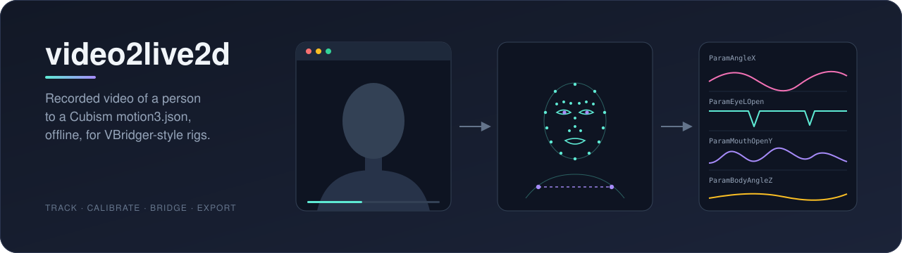
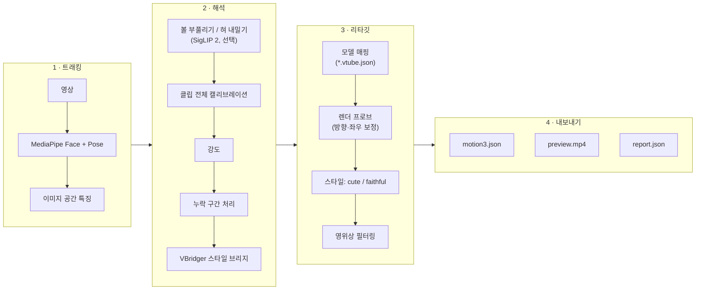
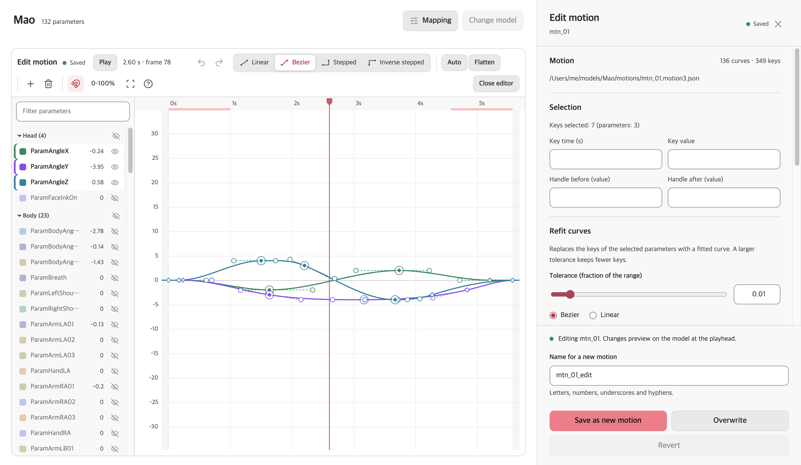
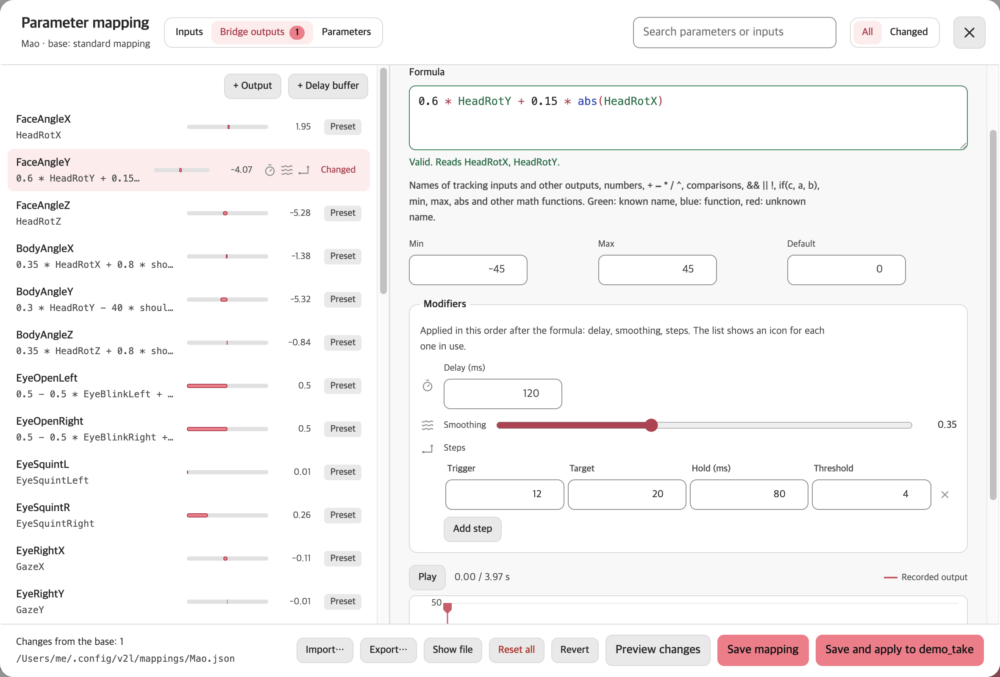
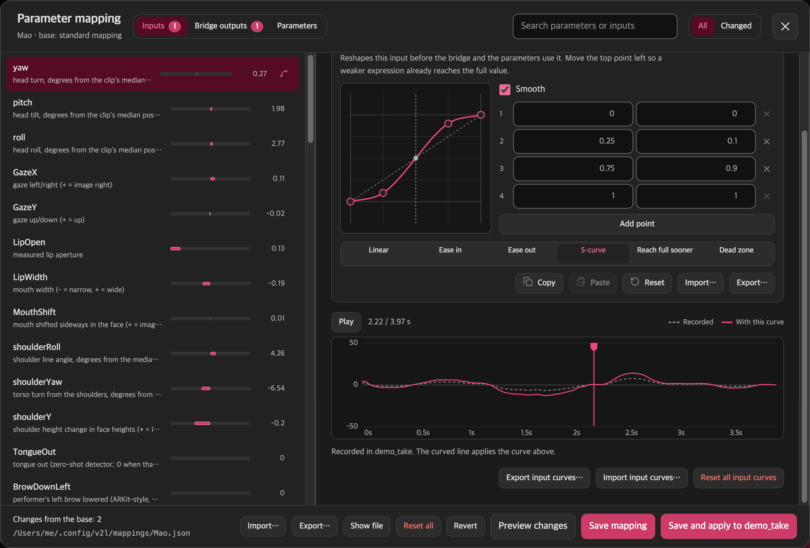
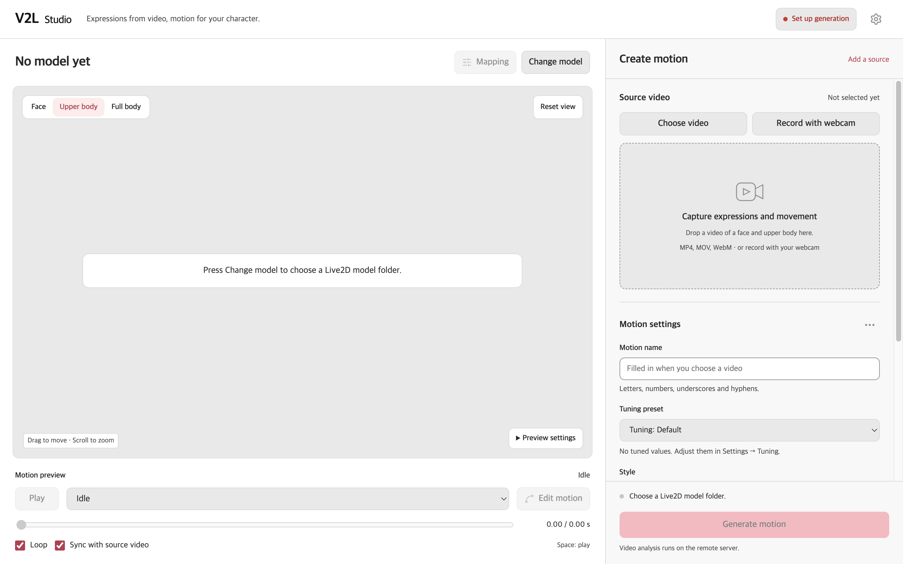
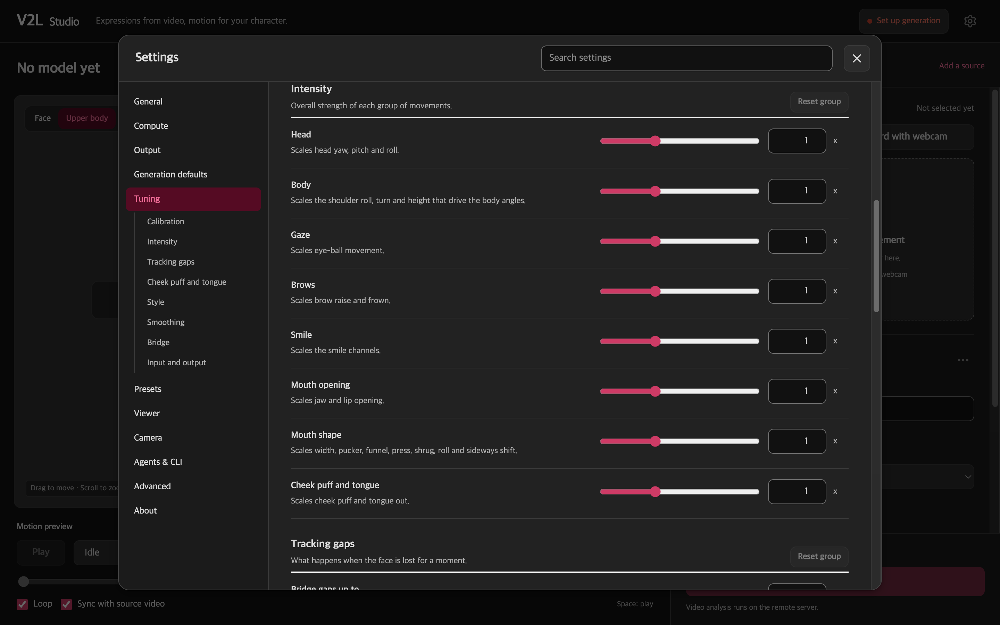
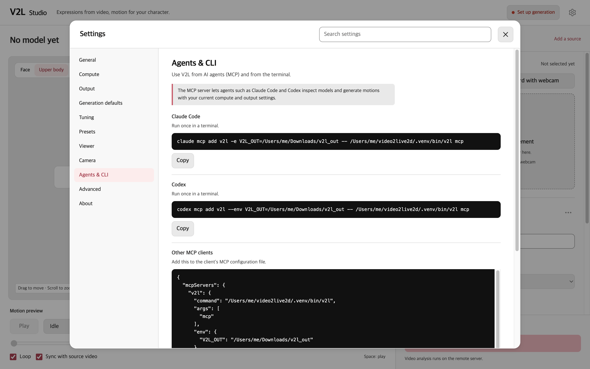

<div align="center">



<p><strong>사람이 찍힌 녹화 영상을 오프라인에서 Live2D Cubism 모션으로 변환합니다.</strong></p>

<p>
<a href="https://github.com/FMsongX2/video2live2d/actions/workflows/ci.yml"></a>
<a href="LICENSE"></a>


</p>

<p><a href="README.md">English</a> · <strong>한국어</strong> · <a href="README.ja.md">日本語</a> · <a href="README.zh-CN.md">简体中文</a></p>

</div>

video2live2d(V2L)는 얼굴과 어깨가 화면에 들어온 실제 사람의 영상을 읽어, VBridger 호환 Live2D 모델용 Cubism `.motion3.json`을 만듭니다. iPhone도, 실시간 트래킹도 필요 없습니다. 클립을 녹화하고 명령 하나를 실행하면 VTube Studio나 다른 Cubism 런타임에서 재생할 수 있는 모션이 나옵니다. 제품 이름은 V2L이고, Python 패키지와 명령 이름은 `v2l`입니다.

## 주요 기능

- **영상을 넣으면 모션이 나옵니다.** 평범한 녹화 클립에서 머리·몸 각도, 눈과 시선, 눈썹, VBridger 입 파라미터 세트, 어깨, 호흡을 만듭니다.
- **자동 캘리브레이션.** 클립에서 가장 움직임이 적은 구간을 기본 표정으로 삼아, VBridger의 수동 Calibrate 버튼을 대신합니다. 구간을 직접 지정할 수도 있습니다.
- **모델 자체 설정을 그대로 사용.** 모델에 `*.vtube.json`(VTube Studio 설정)이 있으면 파라미터 범위, 클램프, 호흡 설정을 거기서 가져오고, 없으면 표준 Cubism 파라미터 id를 사용합니다.
- **리그에 의존하지 않는 방향 점검.** 헤드리스 렌더 프로브가 각 파라미터가 화면에서 실제로 어떻게 움직이는지 측정해, 반대로 된 방향과 좌우가 바뀐 눈을 바로잡습니다. 결과는 모델별로 캐시됩니다.
- **SnenkBridge 형식 브리지.** 내장 VBridger 스타일 브리지는 SnenkBridge 수식 언어의 안전한 인터프리터로 평가되며, `--bridge FILE`로 같은 형식의 다른 프리셋을 불러올 수 있습니다.
- **두 가지 스타일.** `cute`(기본값)는 조금 더 밝고 생기 있는 연기를 더하고, `faithful`은 아무것도 더하지 않습니다.
- **모든 값을 조정할 수 있습니다.** 입력, 캘리브레이션, 강도, 스무딩, 스타일 등 10개 섹션의 설정 67개가 CLI, V2L Studio, MCP 서버가 함께 쓰는 하나의 스키마에서 나옵니다. 내장 프리셋과 사용자 프리셋으로 묶어 쓸 수 있습니다.
- **에이전트 친화적.** `--json`으로 JSON 결과 객체 하나, `--progress json`으로 JSON-lines 진행 이벤트, 문서화된 종료 코드, AI 에이전트용 MCP 서버를 제공합니다.
- **모션 편집.** 구간마다 선형, 베지어, 계단, 역계단을 고를 수 있는 키프레임, 베지어 핸들, 다시 맞추기, 실행 취소를 V2L Studio의 커브 편집기나 `v2l motion` 작업으로 다룹니다.
- **3단계 매핑 편집.** VBridger, SnenkBridge, VTube Studio의 파라미터 설정을 본떴습니다. 입력 커브, 수식과 SnenkBridge식 지연 버퍼·VBridger식 수정자(지연, 스무딩, 단계)가 있는 브리지 출력, 그리고 범위, 반전, 클램프, 반응 커브, 스무딩 차단 주파수를 정하는 파라미터별 매핑입니다.
- **선택 기능: 볼 부풀리기와 혀 내밀기.** 제로샷 SigLIP 2 단계가 MediaPipe가 잘 잡지 못하는 표정을 점수화합니다.
- **미리보기와 리포트.** 원본과 모델을 나란히 보여 주는 미리보기 영상과, 검출률·눈 깜빡임·범위 사용률·경고를 담은 `report.json`을 만듭니다.
- **노트북 + 연산 호스트 워크플로.** 표준 라이브러리만 쓰는 `bin/v2l-remote`가 SSH로 다른 머신에서 파이프라인을 실행하고, V2L Studio는 이를 Live2D 뷰어와 웹캠 녹화가 있는 데스크톱 앱으로 감쌉니다.

## 동작 방식



| 단계 | 소스 | 하는 일 |
|---|---|---|
| 트래킹 | `src/v2l/signals.py` | MediaPipe Face Landmarker(ARKit 이름의 블렌드셰이프 52개, 머리 변환, 랜드마크 478개)와 Pose Landmarker(어깨). |
| 특징 | `src/v2l/features.py` | 머리 yaw/pitch/roll, 눈별 개방도, 홍채 시선, 턱 벌림, 입술 안쪽 간격, 입 너비, 얼굴 기준 입의 좌우 이동, 어깨 roll/yaw/높이. |
| 볼 / 혀 | `src/v2l/rare.py` | 선택 단계. N 프레임마다 SigLIP 2로 제로샷 점수를 매깁니다. |
| 캘리브레이션 | `src/v2l/calibrate.py` | 클립 전체에서 기본 표정(가장 움직임이 적은 구간)과 채널별 반응 폭을 찾습니다. |
| 강도 | `src/v2l/calibrate.py` | 움직임 그룹(머리, 몸, 시선, 눈썹, 미소, 입, 볼/혀)을 `intensity.*` 설정에 따라 배율 조정합니다. |
| 누락 구간 | `src/v2l/temporal.py` | 출력 프레임레이트로 리샘플링합니다. 0.4초(`gaps.max_gap`) 이하의 누락은 보간하고, 더 긴 누락은 기본 자세로 부드럽게 돌아갑니다. |
| 브리지 | `src/v2l/bridge.py`, `src/v2l/bridges/default.json` | SnenkBridge 수식 언어의 안전한 AST 인터프리터로 VBridger 스타일 출력을 계산합니다. 매핑 파일로 출력을 고치거나 추가할 수 있으며, 지연 버퍼와 수정자도 쓸 수 있습니다. |
| 매핑 | `src/v2l/mapping.py`, `src/v2l/model.py` | 모델의 VTube Studio 파라미터 설정을 재사용하고, 없으면 표준 Cubism id로 대체합니다. 매핑 파일(`--mapping`)로 어떤 항목이든 바꾸거나 새로 추가할 수 있습니다. |
| 프로브 | `src/v2l/render.py`, `src/v2l/web/` | 모델을 헤드리스로 렌더링해 반대 방향과 바뀐 눈 좌우를 바로잡습니다. |
| 스타일 | `src/v2l/style.py` | `cute` 또는 `faithful`. |
| 내보내기 | `src/v2l/motion3.py`, `src/v2l/pipeline.py` | 파라미터 그룹별 영위상 Butterworth 필터링, 각 파라미터 범위의 0.4 % 이내로 Ramer-Douglas-Peucker 단순화한 선형 세그먼트(`output.interpolation=bezier`이면 제한된 베지어), 검증, 미리보기와 리포트. |
| 설정 | `src/v2l/config.py`, `src/v2l/presets/` | 모든 단계가 쓰는 설정 스키마, 검증, 프리셋. |
| 편집 | `src/v2l/motionedit.py`, `src/v2l/inputs.py` | 편집 가능한 모션 형식, 편집 작업, 피팅, 검증, 그리고 매핑이 쓸 수 있는 입력 목록. |

물리 연산 출력 파라미터는 런타임에 맡깁니다. 프로브와 미리보기 렌더링은 Playwright가 설치된 Google Chrome을 SwiftShader(CPU 렌더링)로 구동합니다. GPU WebGL 백엔드에서는 매우 큰(8K) 텍스처로 컨텍스트가 유실되었기 때문입니다.

## 요구 사항

**연산 호스트** (`v2l` 실행)

- Linux(x86_64 또는 arm64) 또는 Apple silicon macOS, Python 3.11 이상. MediaPipe는 Intel macOS용 wheel을 배포하지 않습니다.
- Google Chrome 설치(Playwright가 `channel="chrome"`으로 실행합니다).
- ffmpeg를 따로 설치할 필요가 없습니다. `imageio-ffmpeg`에 바이너리가 포함되어 있습니다.
- 선택: 볼/혀 단계용 NVIDIA GPU. 여유 메모리가 3 GB 이상이면 GPU를, 아니면 CPU를 사용하며 CPU에서는 점수를 매기는 프레임당 약 0.8초가 걸립니다.

**노트북** (원격 워크플로와 V2L Studio용)

- V2L Studio: Node.js와 npm, 그리고 `python3`. `PATH`의 `ffmpeg`는 선택 사항이며, Studio가 웹캠 테이크를 리먹스해 탐색이 정확해지도록 할 때 사용합니다.
- 원격 모드(`bin/v2l-remote`, Studio의 **원격 서버**, `bin/v2l-mcp`): `python3`, `rsync`, 그리고 연산 호스트에 키 기반으로 로그인되는 `ssh`.
- 로컬 모드(Studio의 **이 컴퓨터**): 위의 연산 호스트 요구 사항을 같은 머신에서 충족해야 합니다.

연산 호스트와 노트북은 같은 머신이어도 됩니다.

## 빠른 시작

### A. 연산 호스트에서 실행

```bash
git clone https://github.com/FMsongX2/video2live2d.git
cd video2live2d
python3 -m venv .venv && source .venv/bin/activate
pip install -e .
# optional: cheek puff / tongue out (installs torch + transformers)
pip install -e '.[rare]'

v2l run clip.mp4 --model ~/Models/MyModel --name hello
```

결과는 `v2l_out/`(`hello.motion3.json`, `hello.preview.mp4`, `hello.report.json`)에 저장됩니다. `--no-install`을 주지 않으면 모션이 모델 폴더에도 복사됩니다. 트래커 모델과 Live2D Cubism Core는 처음 사용할 때 내려받습니다.

### B. 노트북 + 연산 호스트

```bash
export V2L_HOST=user@gpu-box          # required, no default
export V2L_DIR=v2l                    # optional, relative to the remote home

bin/v2l-remote setup                  # push code, create .venv, install, pre-download tracker models, Cubism Core and renderer libraries
bin/v2l-remote run clip.mp4 --model ~/Models/MyModel --name hello --out ~/Downloads/v2l_out
```

`run`은 영상과 모델 폴더를 업로드하고, 호스트에서 `v2l run`을 실행한 뒤 결과를 `~/Downloads/v2l_out/hello/`로 가져옵니다. `--no-install`을 주지 않으면 모션이 로컬 모델 폴더에도 복사됩니다. 그 밖의 `v2l run` 옵션(`--preset`, `--config`, `--set`, 단축 플래그)도 쓸 수 있습니다. 연결은 `bin/v2l-remote check`로 확인합니다. 코드를 업데이트한 뒤에는 `setup`을 다시 실행하세요. 호스트에서 볼/혀 단계를 쓰려면 호스트의 `V2L_DIR` 안에서 `.venv/bin/pip install -e '.[rare]'`를 실행합니다.

### C. V2L Studio

```bash
bin/v2l-studio
# optional: values from the environment (shown locked in Settings)
V2L_MODEL=~/Models/MyModel V2L_HOST=user@gpu-box bin/v2l-studio
```

처음 실행할 때 `app/`에서 `npm install`을 수행합니다. 모션을 생성하려면 연산 환경이 필요하며, **설정 → 연산**에서 고릅니다.

- **원격 호스트:** `user@gpu-box`를 입력하고 **연결 테스트**를 누른 뒤 **연산 서버 설정**을 누릅니다(`bin/v2l-remote setup` 실행).
- **이 컴퓨터:** **이 컴퓨터 설정**을 누르거나(저장소에 `.venv`를 만들고 V2L을 설치), A처럼 `.venv` 안에서 `pip install -e .`로 직접 설치합니다.

`V2L_HOST`, `V2L_MODEL` 같은 환경 변수도 그대로 동작하며, 해당 설정을 잠급니다.

## 사용법 레퍼런스

### `v2l run`

```text
v2l run VIDEO --model DIR --name NAME [--out DIR] [--preset NAME|FILE] [--config FILE]...
        [--set SECTION.NAME=VALUE]... [shortcut flags] [--mapping FILE] [--dump-signals]
        [--no-install] [--dry-run] [--json] [--progress text|json]
```

설정은 다음 순서로 적용되며, 뒤에 오는 것이 우선합니다.

**기본값 < `--preset` < `--config` 파일(순서대로) < 단축 플래그 < `--set`(순서대로)**

<details>
<summary>전체 옵션</summary>

| 옵션 | 기본값 | 의미 |
|---|---|---|
| `--model DIR` | 필수 | Live2D 모델 폴더(`*.model3.json`, 선택적으로 `*.vtube.json`). |
| `--name NAME` | 필수 | 출력 이름. 모션 파일은 `NAME.motion3.json`입니다. |
| `--out DIR` | `v2l_out` | 출력 폴더. 파일은 이 폴더에 바로 저장됩니다. |
| `--preset NAME\|FILE` | 없음 | 내장 프리셋, 사용자 프리셋 또는 프리셋 파일([설정과 프리셋](#설정과-프리셋) 참고). |
| `--config FILE` | 없음 | JSON 설정 파일. 여러 번 지정할 수 있으며 뒤의 파일이 우선합니다. |
| `--set SECTION.NAME=VALUE` | 없음 | 설정 하나. 예: `intensity.smile=1.5`, `calibration.neutral_window=2:3`. 여러 번 지정할 수 있으며 마지막에 적용됩니다. |
| `--mapping FILE` | 없음 | 매핑 파일([모션과 매핑 편집](#모션과-매핑-편집) 참고). |
| `--dump-signals` | 끔 | `NAME.signals.json`도 씁니다. 프레임별 트래킹 입력과 브리지 출력이 들어 있습니다. |
| `--no-install` | 끔 | 모션을 모델 폴더에 복사하지 않습니다. |
| `--dry-run` | 끔 | 입력과 설정을 점검하고, 예정된 출력 파일과 최종 설정을 출력합니다. 트래킹은 하지 않습니다. |
| `--json` | 끔 | stdout에 JSON 결과 객체 하나만 출력하고, 나머지는 모두 stderr로 보냅니다. |
| `--progress text\|json` | `text` | `json`: stderr의 모든 줄이 JSON 이벤트입니다(아래 참고). |

</details>

<details>
<summary>단축 플래그(각각 설정 하나를 지정)</summary>

| 플래그 | 설정 | 의미 |
|---|---|---|
| `--style cute\|faithful` | `style.name` | `cute`(기본값)는 조금 더 밝은 기본 표정, 웃을 때 눈웃음과 홍조, 약간 큰 평상시 눈, 조금 더 많은 머리 움직임을 더하고, 모델에 `ParamEyeSparkle`이 있으면 길고 크게 웃을 때 반짝이는 눈을 넣습니다. `faithful`은 아무것도 더하지 않습니다. |
| `--fps N` | `output.fps` | 출력 프레임레이트(기본값 30). |
| `--fade S` | `output.fade` | 페이드 인/아웃 시간(초, 기본값 0.5). |
| `--loop` | `output.loop=true` | 모션이 끊김 없이 반복되게 합니다(대기 애니메이션용). |
| `--flip` | `input.flip=true` | 입력이 좌우 반전으로 녹화되었습니다(셀피 카메라). |
| `--start S`, `--end S` | `input.start`, `input.end` | 클립의 일부만 사용합니다(초). |
| `--neutral A:B` | `calibration.neutral_window` | 기본 표정 구간(초). `--start` 기준입니다. 기본값: 자동 탐색. |
| `--bridge NAME\|FILE` | `bridge.preset` | 내장 브리지 프리셋 이름(기본값 `default`) 또는 SnenkBridge 형식 JSON 파일. 파라미터 목록 그대로이거나 `snek` 프리셋이며, `delayBuffer` 출력도 지원합니다. |
| `--no-preview` | `preview.enabled=false` | 미리보기 영상을 만들지 않습니다. |
| `--no-rare` | `expressions.enabled=false` | 볼 부풀리기 / 혀 내밀기 단계를 건너뜁니다. |
| `--rare-stride N` | `expressions.stride` | N 프레임마다 볼 부풀리기 / 혀 내밀기 점수를 매깁니다(기본값 3). |

</details>

**커브 보간.** `output.interpolation`의 기본값은 `linear`입니다. `--set output.interpolation=bezier`는 제한된 베지어 세그먼트를 씁니다. 키는 약 절반으로 줄고 편집하기 쉬워지지만, 베지어 세그먼트 하나가 점 세 개로 계산되므로 파일은 커집니다.

**JSON 결과** (`--json`):

```text
{"ok": true, "name": "hello", "out_dir": "...", "files": {"motion": "...", "report": "...", "preview": "..." | null},
 "installed": "..." | null, "summary": {...}}
{"ok": false, "error": {"type": "...", "message": "..."}}
```

`--dry-run`이면 결과에 `"summary"` 대신 `"dry_run": true`와 `"settings"`가 들어갑니다.

**진행 이벤트** (`--progress json`, stderr 한 줄에 JSON 객체 하나):

| 이벤트 | 필드 |
|---|---|
| `stage` | `stage`: `probe`, `tracking`, `expressions`, `solving`, `writing`, `preview` 중 하나(`v2l-remote`는 맨 앞에 `upload`, 맨 뒤에 `download`를 추가합니다). |
| `progress` | `stage`, `done`, `total`. 약 0.5초마다, 그리고 마지막 값은 항상 보냅니다. |
| `log` | `message`. 트래커와 라이브러리의 출력도 이 이벤트로 감쌉니다. |

**종료 코드** (`v2l`과 `v2l-remote` 공통):

| 코드 | 오류 유형 |
|---|---|
| `0` | 성공 |
| `1` | `runtime`, `remote` |
| `2` | `usage`, `config`, `input`, `invalid`(검증을 통과하지 못한 모션, 편집 작업, 매핑, 수식) |
| `3` | `unusable_input`: 영상이 열리지 않거나 얼굴이 트래킹되지 않음 |
| `4` | `remote_unreachable`: 연산 호스트에 연결할 수 없음 |
| `130` | `interrupted`, `cancelled` |

### 그 밖의 `v2l` 명령

| 명령 | 하는 일 |
|---|---|
| `v2l probe --model DIR [--details] [--json]` | 모델의 파라미터 범위를 읽고 화면상의 방향을 측정합니다(모델별 캐시). `--details`는 프로브한 모든 파라미터의 측정 결과를 추가합니다. |
| `v2l presets list [--json]` | 내장 프리셋과 사용자 프리셋 목록. |
| `v2l presets show NAME\|FILE` | 프리셋의 설정을 JSON으로 보여 줍니다. |
| `v2l presets save NAME FILE` | `FILE`을 검증해 사용자 프리셋 `NAME`으로 저장합니다. |
| `v2l config schema` | 모든 설정의 타입, 기본값, 범위, 단위, 도움말, `affects`를 JSON으로 출력합니다. |
| `v2l config defaults` | 기본 설정을 JSON으로 출력합니다. |
| `v2l config presets` | 내장 프리셋과 사용자 프리셋을 JSON으로 출력합니다. |
| `v2l config validate FILE...` | 설정 파일을 검사하고 병합 결과를 출력합니다. |
| `v2l version [--json]` | V2L 버전. |
| `v2l motion info\|read\|write\|edit\|refit\|eval\|validate ...` | 모션 파일을 살펴보고, 변환하고, 편집하고, 다시 맞추고, 샘플링하고, 검증합니다. |
| `v2l mapping show\|inputs\|validate ...` | 각 값의 출처를 포함한 모델의 최종 매핑, 매핑이 쓸 수 있는 입력, 매핑 파일 검증. |
| `v2l bridge show\|check\|validate ...` | 최종 브리지 출력, 수식 하나 검사, SnenkBridge 프리셋이나 매핑의 bridge 섹션 검증. |
| `v2l mcp [...]` | MCP 서버([에이전트](#에이전트-mcp--cli) 참고). |

`v2l config`, `v2l presets`, `v2l version`, `v2l motion`, `v2l bridge`, 그리고 `--model` 없이 쓰는 `v2l mapping inputs|validate`는 표준 라이브러리만 있으면 됩니다. 형식과 모든 옵션: [docs/motion-editing.md](docs/motion-editing.md).

### `bin/v2l-remote`

| 명령 | 하는 일 |
|---|---|
| `setup` | `V2L_HOST`에 코드를 올리고 `.venv`를 만든 뒤 `pip install -e '.[test]'`를 실행하고, 트래커 모델, Cubism Core, 렌더러 라이브러리를 미리 내려받습니다. |
| `run VIDEO --model DIR --name NAME [--out DIR] [--no-install] [--json] [--progress text\|json] [v2l run options...]` | 호스트에서 `v2l run`을 실행하고 결과를 `OUT/NAME/`으로 가져옵니다(`--out` 기본값은 `V2L_OUT`, 없으면 `~/Downloads/v2l_out`). |
| `probe --model DIR [--details] [--json]` | 로컬 모델을 호스트에서 프로브합니다. |
| `mapping show --model DIR [--mapping FILE] [--json]` | 로컬 모델의 최종 매핑을 호스트에서 계산합니다. |
| `mapping inputs\|validate ...`, `bridge ...` | 노트북에서 실행하며 `V2L_HOST`가 필요 없습니다. |
| `check [--json]` | 호스트에 연결되는지, V2L이 설치되어 있는지 확인합니다. |
| `version [--json]` | 로컬 V2L 코드의 버전. |
| `test` | 호스트에서 단위 테스트를 실행합니다. |
| `regress` | `V2L_REGRESS_MODEL`의 모델로 호스트에서 회귀 하네스를 실행합니다. |

`v2l-remote run`의 설정과 작업 처리 방식:

- `--preset`, `--config` 파일, 단축 플래그, `--set`은 **노트북에서** 해석되므로 사용자 프리셋과 로컬 파일이 그대로 쓰입니다. 실행마다 최종 설정을 담은 파일 하나(로컬 브리지 파일이 있으면 그것도)를 업로드하고 끝나면 지웁니다. 잘못된 설정은 업로드 전에 실패합니다.
- `--dry-run`은 연결 없이 노트북에서 실행됩니다.
- `--mapping FILE`은 설정 파일처럼 업로드되고 실행 후 지워집니다. `--dump-signals`를 주면 신호 파일도 결과와 함께 돌아옵니다.
- `v2l-remote`를 멈추면(Ctrl-C, SIGTERM, SIGHUP) 호스트의 작업도 멈추고 그 실행의 파일을 지운 뒤 130으로 종료합니다.

### 환경 변수

| 변수 | 사용처 | 의미 |
|---|---|---|
| `V2L_HOST` | `v2l-remote`, Studio, MCP 서버 | 연산 호스트의 SSH 대상(예: `user@gpu-box`). `v2l-remote`에 필수이며 기본값이 없습니다. MCP 서버에서는 원격 모드를 켭니다. |
| `V2L_DIR` | `v2l-remote`, Studio, MCP 서버(원격 모드) | 호스트의 작업 디렉터리. 기본값 `v2l`(원격 홈 기준 상대 경로). |
| `V2L_OUT` | `v2l-remote`, Studio, MCP 서버 | 출력 폴더(`v2l-remote run --out`의 기본값). 기본값 `~/Downloads/v2l_out`. |
| `V2L_MODEL` | Studio | 시작할 때 열 모델 폴더. 선택. |
| `V2L_CUBISM_CORE` | `v2l` | 내려받는 대신 사용할 로컬 `live2dcubismcore.min.js` 경로. |
| `V2L_REGRESS_MODEL` | `v2l-remote regress` | 회귀 실행에 쓸 모델 폴더. `regress`에 필수. |
| `XDG_CONFIG_HOME` | `v2l`, `v2l-remote`, MCP 서버 | 사용자 프리셋 위치는 `$XDG_CONFIG_HOME/v2l/presets`(기본값 `~/.config/v2l/presets`)입니다. |

## 설정과 프리셋

조정 가능한 값은 모두 하나의 스키마 `src/v2l/config.py`에 있습니다. 10개 섹션에 설정 67개입니다. CLI, V2L Studio, MCP 서버가 같은 스키마를 읽으므로 설정 이름, 범위, 의미가 어디서나 같습니다. 알 수 없는 키, 잘못된 타입, 범위를 벗어난 값은 오류입니다.

| 섹션 | 조정 대상 | 예시 키 |
|---|---|---|
| `input` | 영상의 어느 부분을 어떻게 읽을지. | `start`, `end`, `flip` |
| `output` | 모션의 프레임레이트, 페이드, 반복, 파일 크기. | `fps`, `loop`, `interpolation` |
| `calibration` | 기본 표정과 각 표정의 최대 폭을 추정하는 방법. | `neutral_window`, `jaw_full`, `gaze_full` |
| `intensity` | 움직임 그룹별 전체 세기. | `head`, `smile`, `mouth_open` |
| `gaps` | 얼굴을 잠시 놓쳤을 때의 처리. | `max_gap`, `ramp` |
| `expressions` | 선택 단계인 볼 부풀리기 / 혀 내밀기. | `enabled`, `stride`, `cheek_thresholds` |
| `bridge` | 트래킹 입력에서 브리지 출력으로 가는 VBridger 스타일 수식. | `preset` |
| `style` | 트래킹한 움직임 위에 더하는 연기 스타일. | `name`, `blush_smile`, `head_gain` |
| `filtering` | 파라미터 그룹별 영위상 저역 통과 필터. | `cutoff_scale`, `head`, `mouth` |
| `preview` | 나란히 보여 주는 미리보기 영상. | `enabled`, `width`, `height` |

<details>
<summary>섹션별 전체 설정 이름</summary>

| 섹션 | 설정 |
|---|---|
| `input` | `start`, `end`, `flip`, `analysis_width` |
| `output` | `fps`, `fade`, `loop`, `loop_blend`, `breath_period`, `interpolation`, `tolerance` |
| `calibration` | `neutral_window`, `neutral_seconds`, `rest_head_range`, `full_percentile`, `min_span`, `max_gain`, `blink_deadzone`, `blink_landmark_weight`, `eye_closed_ratio`, `eye_wide_range`, `jaw_full`, `lip_gap_full`, `mouth_narrow_full`, `mouth_wide_full`, `mouth_shift_full`, `gaze_full` |
| `intensity` | `head`, `body`, `gaze`, `brows`, `smile`, `mouth_open`, `mouth_shape`, `cheek_tongue` |
| `gaps` | `max_gap`, `ramp` |
| `expressions` | `enabled`, `stride`, `cheek_thresholds`, `tongue_thresholds` |
| `bridge` | `preset` |
| `style` | `name`, `mouth_form_bias`, `eye_smile_max`, `blush_rest`, `blush_smile`, `eye_open_scale`, `head_gain`, `sparkle_param`, `sparkle_smile`, `sparkle_hold` |
| `filtering` | `despike`, `cutoff_scale`, `head`, `body`, `eyeball`, `eye_open`, `brows`, `smile`, `mouth`, `blush`, `sparkle`, `other` |
| `preview` | `enabled`, `width`, `height` |

</details>

타입, 기본값, 범위, 단위, 도움말은 `v2l config schema`(또는 표준 라이브러리만 필요한 `python -m v2l.config schema`)로 확인하세요.

**변경이 미치는 범위.** 각 설정에는 `affects` 값이 있습니다.

- `tracking`: 영상을 다시 트래킹합니다(`input.*`, `expressions.enabled`, `expressions.stride`).
- `solve`: 캐시된 트래킹 결과를 재사용하고 모션만 다시 계산합니다(대부분의 설정). 트래킹 캐시는 `v2l`을 실행하는 머신의 `~/.cache/v2l`에 있으므로, 같은 클립을 solve 설정만 바꿔 다시 실행하면 트래킹을 건너뜁니다.
- `output`: 미리보기 렌더링만 바뀝니다(`preview.*`).

**내장 프리셋**

| 프리셋 | 설명 |
|---|---|
| `default` | V2L 기본값: cute 스타일, 자동 기본 표정, 표준 스무딩. |
| `faithful` | 카메라에 보이는 것만: 미소, 홍조, 눈, 머리 스타일링을 더하지 않습니다. |
| `calm` | 말하기, 낭독, ASMR 스타일 클립에 맞게 머리와 몸의 움직임을 더 작고 부드럽게. |
| `lively` | 활기찬 클립에 맞게 머리, 몸, 얼굴의 움직임을 더 크게. |
| `idle_loop` | 끊김 없는 대기 애니메이션: 반복, 온전한 호흡 주기, 부드러운 스무딩. |

사용자 프리셋은 `$XDG_CONFIG_HOME/v2l/presets`(기본값 `~/.config/v2l/presets`)에 둡니다. 내장 프리셋과 이름이 같은 사용자 프리셋은 내장 프리셋을 대신합니다. 프리셋은 선택적인 `meta` 블록이 있는 설정 파일입니다.

```json
{
  "version": 1,
  "meta": {"name": "Talk show", "description": "Calmer head, stronger smile."},
  "intensity": {"head": 0.8, "smile": 1.3},
  "filtering": {"cutoff_scale": 0.8}
}
```

```bash
v2l config validate talk_show.json
v2l presets save talk_show talk_show.json
v2l run clip.mp4 --model ~/Models/MyModel --name hello --preset talk_show --set intensity.smile=1.5
```

## 모션과 매핑 편집

모션과 매핑은 생성한 뒤에도 CLI, MCP 서버, V2L Studio에서 편집할 수 있습니다. 파일 형식, 모든 작업, 수식 문법, 모든 명령 옵션은 전체 명세인 [docs/motion-editing.md](docs/motion-editing.md)에 있습니다.

### 모션

모션은 일반적인 `.motion3.json` 파일입니다. 두 키 사이의 각 구간은 선형, 베지어, 계단, 역계단 중 하나입니다. V2L은 **제한된 베지어**(`AreBeziersRestricted`)를 씁니다. 두 제어점이 구간 시간의 1/3과 2/3 지점에 있어 값이 시간에 대한 3차 다항식이 되므로, 모든 Cubism 런타임이 같은 방식으로 계산합니다. 편집기는 제어값만 바꿉니다. 다른 도구가 만든 베지어는 정확히 읽고, 그 구간을 편집할 때만 변환합니다.

`v2l motion read`는 편집 가능한 JSON(키, 구간별 유형, 핸들)을 돌려줍니다. `v2l motion edit`는 작업 목록을 순서대로 적용합니다: 키 추가·이동·삭제, 보간과 핸들 설정, 자동·평탄 접선, 다시 맞추기, 배율, 오프셋, 클램프, 시간 조정, 자르기, 타이밍. 잘못된 작업은 그 순번과 함께 보고되며 아무것도 쓰지 않습니다. 기존 출력 파일은 `--overwrite`가 있을 때만 바꿉니다.

```json
[
  {"op": "insert_key", "curve": "ParamAngleX", "t": 1.0, "value": 12},
  {"op": "set_interpolation", "curves": ["ParamAngleX"], "type": "bezier", "from": 0.5, "to": 2.0},
  {"op": "refit", "curves": "*", "tolerance": 0.004, "interpolation": "bezier"},
  {"op": "trim", "from": 1.0, "to": 13.0}
]
```

```bash
v2l motion read hello.motion3.json --json                # editable JSON: keys, segment types, handles
v2l motion edit hello.motion3.json --ops ops.json --out hello_edit.motion3.json --json
v2l motion refit hello.motion3.json --interpolation bezier --tolerance 0.004 --out hello_bezier.motion3.json
```

### 매핑

매핑 파일(`--mapping FILE`)은 모델별로 트래킹이 Live2D 파라미터에 닿는 방식을 바꿉니다. 세 단계로 되어 있고, 트래킹 뒤에 이 순서로 적용됩니다.

| 단계 | 본뜬 대상 | 바꾸는 것 |
|---|---|---|
| `input_curves` | VBridger의 입력 커브 | 트래킹 입력의 모양을 바꿉니다. 예: 끝까지 뜨지 않는 눈도 1에 닿게 하기. |
| `bridge` | SnenkBridge 프리셋, VBridger 수정자 | 브리지 출력을 고치거나 추가하거나 끕니다: 수식, SnenkBridge식 `delayBuffer`, 수정자 `delayMs`, `smoothing`, `steps`. |
| `entries` | VTube Studio 파라미터 설정 | Live2D 파라미터별로 입력, 입력·출력 범위, 반전, 클램프, 반응 커브, 스무딩 차단 주파수, 호흡, 켜기/끄기. |

```json
{
  "format": "v2l.mapping",
  "version": 1,
  "input_curves": {"EyeWideLeft": {"points": [[0, 0], [0.6, 1], [1, 1]], "smooth": true}},
  "bridge": [
    {"name": "MouthOpen", "modifiers": {"smoothing": 0.2}},
    {"name": "EarSwing", "func": "", "min": -1, "max": 1, "defaultValue": 0,
     "delayBuffer": {"refParam": "FaceAngleX", "smoothing": 3, "delayCount": 8,
                     "inMin": -20, "inMax": 20, "outMin": -1, "outMax": 1}}
  ],
  "entries": [
    {"output": "ParamAngleX", "in": [-25, 25], "out": [-30, 30], "cutoff": 2.0},
    {"output": "ParamEarL", "input": "EarSwing"},
    {"output": "ParamBodyAngleZ", "enabled": false}
  ]
}
```

```bash
v2l mapping inputs --json                               # input names, meaning, nominal range
v2l mapping show --model ~/Models/MyModel --mapping MyModel.json
v2l bridge check --func "0.5 + 0.5 * (MouthSmileLeft + MouthSmileRight)"
v2l run clip.mp4 --model ~/Models/MyModel --name hello --mapping MyModel.json --dump-signals
```

바꾼 값만 저장되고, 나머지는 렌더 프로브의 방향 보정을 거친 모델의 `*.vtube.json` 또는 표준 매핑에서 가져옵니다. 수식은 SnenkBridge 문법을 따르며, 차이점은 명세에 정리되어 있습니다. 세 단계는 트래킹 뒤에 적용되므로, 매핑을 바꿔도 트래킹 캐시를 재사용합니다. `--dump-signals`는 프레임별 입력과 브리지 출력을 담은 `NAME.signals.json`을 써서, 매핑이 보는 값을 그래프로 그릴 수 있게 합니다.

### V2L Studio에서

모션 편집기와 매핑 편집기([V2L Studio](#v2l-studio) 참고)는 같은 형식을 다루고 같은 작업을 호출합니다.

<p align="center"></p>

<p align="center">


</p>

## 에이전트 (MCP & CLI)

AI 에이전트는 두 가지 방법으로 V2L을 다룰 수 있습니다. `--json`과 `--progress json`을 쓰는 CLI, 그리고 stdio로 동작하는 [MCP](https://modelcontextprotocol.io/) 서버입니다. 이미 셸 명령을 실행하는 코딩 에이전트에는 CLI가 더 가볍습니다. MCP 서버는 채팅·데스크톱 클라이언트에 적합합니다.

**설치**

- 로컬 모드(이 머신에서 트래킹): `pip install -e '.[mcp]'` 후 `v2l mcp`를 실행합니다.
- 원격 모드(노트북에서 실행, 작업은 `v2l-remote`를 통해 `V2L_HOST`에서 실행): `bin/v2l-mcp`를 사용합니다. `python3`, `rsync`, `ssh`, 그리고 `mcp` 패키지만 있으면 되며, `mcp`가 없으면 [uv](https://docs.astral.sh/uv/)가 제공합니다.

`V2L_HOST`가 설정되어 있으면 서버는 항상 원격 모드로 동작합니다.

**클라이언트에 등록** (`/abs/path`와 `user@gpu-box`는 자신의 값으로 바꾸세요):

```bash
# local mode
claude mcp add v2l -- /abs/path/video2live2d/.venv/bin/v2l mcp
# remote mode
claude mcp add v2l -e V2L_HOST=user@gpu-box -e V2L_DIR=v2l -- /abs/path/video2live2d/bin/v2l-mcp
codex mcp add v2l --env V2L_HOST=user@gpu-box --env V2L_DIR=v2l -- /abs/path/video2live2d/bin/v2l-mcp
```

JSON으로 설정하는 클라이언트:

```json
{
  "mcpServers": {
    "v2l": {
      "command": "/abs/path/video2live2d/bin/v2l-mcp",
      "env": {"V2L_HOST": "user@gpu-box", "V2L_DIR": "v2l", "V2L_OUT": "/Users/me/Downloads/v2l_out"}
    }
  }
}
```

**도구**

| 도구 | 하는 일 |
|---|---|
| `v2l_params(section?)` | 설정 스키마, 기본값, 프리셋. 섹션 하나만 지정할 수도 있습니다. |
| `v2l_validate_settings(settings?, preset?)` | 설정만 시험 적용: 프리셋과 부분 설정을 적용하고 검사합니다. |
| `v2l_probe_model(model, details?)` | 모델의 파라미터와 화면상 방향을 프로브합니다. |
| `v2l_list_motions(model)` | 모델 폴더의 `*.motion3.json` 파일 목록. |
| `v2l_mapping_get(model, mapping?)` | 모델의 최종 매핑(세 단계 모두)과 쓸 수 있는 입력. |
| `v2l_bridge_check(func, mapping?)` | 브리지 수식 하나를 검사합니다: 읽는 이름, 알 수 없는 이름, 오류 위치. |
| `v2l_motion_info(motion)` | 모션의 커브, 세그먼트 유형, 개수, 문제점. |
| `v2l_motion_read(motion, curves?)` | 모션을 편집 가능한 JSON으로. |
| `v2l_motion_edit(motion, operations, out, overwrite?, ranges?)` | 편집 작업을 적용하고 결과를 새 모션으로 씁니다. |
| `v2l_generate(video, model, name, preset?, settings?, mapping?, preview?, out_dir?, install?, job?, wait_seconds?)` | 생성 작업을 시작하거나 이어 갑니다. |
| `v2l_job_status(job, wait_seconds?)` | 작업을 기다렸다가 진행 상황이나 결과를 돌려줍니다. |
| `v2l_jobs()` | 알려진 모든 작업. |
| `v2l_job_cancel(job)` | 대기 중이거나 실행 중인 작업을 멈춥니다(원격 모드에서는 호스트의 프로세스도). |
| `v2l_install_motion(motion, model, overwrite?)` | 모션을 모델 폴더에 복사합니다(`install` 툴셋에서만). |

**긴 작업.** `v2l_generate`는 진행 알림을 보내며 최대 45초(기본값 40초, 일반적인 클라이언트의 60초 요청 제한보다 짧음) 기다린 뒤 결과나 작업 핸들을 돌려줍니다. 핸들로 `v2l_job_status`를 호출해 계속 기다리면 됩니다. 같은 요청(같은 영상·모델 내용, 설정, 이름, 출력 폴더)을 다시 보내면 두 번째 실행을 시작하지 않고 같은 작업을 이어 갑니다. 작업은 한 번에 하나씩 실행되며, 뒤의 작업은 `queued` 상태가 됩니다. 작업 기록은 `~/.cache/v2l/jobs/`에 저장됩니다.

**서버 플래그**

| 플래그 | 의미 |
|---|---|
| `--read-only` | 모션을 생성, 취소, 설치하는 도구를 숨깁니다. |
| `--toolsets inspect,generate,install` | 켤 도구 그룹(기본값 `inspect,generate`). |
| `--allow-dir DIR` | 모든 경로 인자가 이 폴더들 중 하나 안에 있어야 합니다(여러 번 지정 가능). 출력 폴더는 출력용으로 항상 허용됩니다. |

**안전**

- 연산 호스트는 도구 인자가 아니라 `V2L_HOST` / `V2L_DIR`에서만 정해집니다.
- 경로는 절대 경로이거나 `~`로 시작해야 하며, 이름은 `^[A-Za-z0-9_-]{1,80}$`에 맞아야 합니다.
- 모델 폴더에 설치하는 기능은 기본적으로 꺼져 있습니다. `install` 툴셋을 켜지 않으면 `install=true`는 거부됩니다.
- 기존 `<out>/<name>/`은 절대 덮어쓰지 않습니다. 실패하거나 취소된 작업은 자신의 출력 폴더를 지우므로, 다시 시도할 때 같은 이름을 쓸 수 있습니다.
- `v2l_motion_edit`는 출력 폴더나 `--allow-dir` 폴더 안에만 쓰고, 모델 폴더에는 `install` 툴셋이 있을 때만 쓰며, `--read-only`에서는 숨겨집니다.

**GUI 클라이언트와 `PATH`.** 데스크톱 앱은 최소한의 `PATH`로 시작하는 경우가 많아 `v2l`, `uv`, `rsync`, `ssh`를 찾지 못할 수 있습니다. 클라이언트 설정에는 절대 경로를 쓰고, `bin/v2l-mcp`에 필요한 도구가 표준 위치에 있는지 확인하세요. 터미널에서 실행하면 서버가 MCP 클라이언트를 기다리는 중이라는 안내를 출력합니다. 멈춘 것이 아닙니다.

## V2L Studio

<p align="center">


</p>

V2L Studio(`bin/v2l-studio`)는 한쪽에 Live2D 뷰어, 다른 쪽에 생성 패널이 있는 Electron 데스크톱 앱입니다.

- **뷰어.** 프레이밍 프리셋, 드래그와 확대/축소, 물리 연산 토글, 스크럽 바. **Space**로 재생을 켜고 끕니다. 텍스처는 4K로 제한한 보기용 사본으로 표시하며, 모델 폴더는 수정하지 않습니다.
- **생성 패널.** 영상을 고르거나 끌어다 놓거나, 웹캠 테이크를 녹화합니다. 모션 이름, 튜닝 프리셋, 스타일을 정하고, 필요하면 구간 자르기, 기본 표정 구간, 볼/혀 인식, 좌우 반전을 설정합니다. ⋯ 메뉴에서 이 값을 기본값으로 저장하거나 초기화하거나, 실행 내용을 `v2l run` 명령으로 복사할 수 있습니다.
- **생성.** 번호가 붙은 단계 목록(upload, probe, tracking, expressions, solving, writing, preview, download)과 트래킹·표정 점수화의 프레임 진행률을 보여 주며, 원본 로그도 볼 수 있습니다. 실패는 원인별로 표시되고(사용할 수 있는 얼굴 없음, 호스트 연결 불가, 잘못된 설정, 취소), 취소할 때는 확인을 받습니다. 완료된 결과는 원본 영상과 동기화해 비교하거나, 모델 폴더에 저장하거나(덮어쓰기 전 확인), **이 설정 사용**으로 그 설정을 다시 불러오거나, **현재 설정으로 다시 실행**으로 번호를 붙인 이름으로 다시 만들 수 있습니다.
- **모션 편집기.** **모션 편집**(모션 목록 옆이나 결과에 있음)을 누르면 뷰어 아래에 커브 편집기가 붙어 열리며, 뷰어와 원본 영상이 재생 헤드를 따라갑니다. 키를 선택·드래그·추가하고, 베지어 핸들을 편집하고, 구간을 선형·베지어·계단·역계단으로 바꾸고, 자동·평탄 접선을 적용하고, 인스펙터에서 다시 맞추기·배율·자르기·시간 조정을 할 수 있습니다. 모든 변경은 실행 취소와 다시 실행이 되며, 팝오버에 키보드와 마우스 단축키가 정리되어 있습니다. 새 모션으로 저장하거나, 확인 후 덮어쓰거나, 모델 폴더에 저장합니다.
- **매핑 편집기.** 모델 헤더의 **매핑**이나 설정 → 생성 기본값의 **파라미터 매핑**을 누르면 세 단계가 탭(입력, 브리지 출력, 파라미터)으로 열립니다. **변경 사항 미리 보기**는 저장하지 않은 매핑으로 마지막 결과를 트래킹을 재사용해 다시 만들어 재생하고, **남기기** 또는 **버리기**로 그 결과를 둘지 정합니다. 저장한 매핑은 이후의 모든 실행에 전달됩니다.
- **웹캠 테이크.** 3-2-1 카운트다운과 무표정 안내가 나오며, 그 구간이 기본 표정 구간이 됩니다. 테이크 길이는 2.3~60초이고 마이크는 선택해야 켜집니다. 테이크는 `<V2L_OUT>/recordings/`에 저장됩니다.
- **언어와 테마.** 영어, 한국어, 일본어, 중국어 간체와 시스템·라이트·다크 테마를 지원합니다. 중립 색상은 Adobe Spectrum 2에서 가져왔고, 강조색은 라이트 테마에서 코럴(`#FD7688`), 다크 테마에서 Spectrum 마젠타입니다.

### 설정 창

톱니바퀴 버튼, 앱 메뉴, 또는 ⌘,(Linux에서는 Ctrl+,)로 엽니다. 검색 칸은 레이블, 도움말, 키로 모든 설정을 걸러 줍니다.

| 섹션 | 내용 |
|---|---|
| 일반 | 언어, 테마(시스템 / 라이트 / 다크), 기본 모델 폴더, 시작할 때 마지막 모델 열기. |
| 연산 | **원격 서버**(호스트, 원격 디렉터리, **연결 테스트**, **연산 서버 설정**) 또는 **이 컴퓨터**(`v2l` 실행 파일 경로, **테스트**, **이 컴퓨터 설정**). |
| 출력 | 출력 폴더, 같은 결과 이름이 있을 때의 처리, 모델 폴더 자동 저장(기본값 끔), 미리보기 영상(Studio에서는 기본값 끔). |
| 생성 기본값 | 기본 프리셋, 스타일, 반복, 좌우 반전, 볼/혀와 간격, 프레임레이트, 페이드, 브리지 프리셋, 커브 보간, 파라미터 매핑. |
| 튜닝 | 스키마의 모든 설정을 [설정과 프리셋](#설정과-프리셋)과 같은 묶음으로 보여 줍니다. 고급 항목은 토글 뒤에 있고, 항목과 그룹마다 초기화할 수 있으며, 트래킹을 바꾸는 항목에는 "영상 다시 트래킹" 배지가 붙습니다. |
| 프리셋 | CLI와 공유하는 내장 프리셋과 사용자 프리셋: 적용, 현재 튜닝 저장, 이름 변경, 삭제, 가져오기, 내보내기. |
| 뷰어 | 물리 연산, 4K 텍스처, 프레이밍, 반복, 동기화의 기본값. |
| 카메라 | 기본 카메라와 오디오 녹음 여부. |
| 에이전트 및 CLI | 복사할 수 있는 `claude mcp add`, `codex mcp add` 명령과 MCP 서버용 클라이언트 JSON, 그리고 현재 설정을 담은 `v2l run` 명령 하나. 실행 파일, 호스트, 출력 폴더가 채워져 있습니다. |
| 고급 | 로그 필터, 모델 캐시 비우기, 전체 설정 내보내기/가져오기, 모두 초기화. |
| 정보 | 버전, 라이선스, 서드파티 고지, 경로와 호스트 이름이 빠진 진단 정보 복사. |

<p align="center"></p>

**저장.** 변경 사항은 앱 데이터 폴더(`v2l-studio`)의 `settings.json`에 즉시 저장되며, 기본값과 다른 값만 기록됩니다. 우선순위: 스키마 기본값 < Studio 설정 < 환경 변수 < 생성 패널의 실행별 값. 환경 변수(`V2L_HOST`, `V2L_DIR`, `V2L_OUT`, `V2L_MODEL`)로 정해진 값은 잠긴 상태로 표시됩니다.

**실행 위치.** 뷰어, 녹화, 파일 처리는 노트북에서 실행됩니다. 트래킹·해석·프로브는 설정 → 연산에서 고른 대로 원격 호스트(`bin/v2l-remote` 경유) 또는 이 컴퓨터(로컬 `v2l` 경유)에서 실행됩니다. 연산 환경을 설정하기 전에는 연결 버튼이 **생성 설정 필요**로 표시되며, 누르면 설정 → 연산이 열립니다.

## 출력 파일

`--name hello`일 때 `v2l run`은 아래 파일을 `--out` 폴더(기본값 `v2l_out/`)에 바로 쓰고, `bin/v2l-remote run`과 Studio는 `<out>/hello/`(기본값 `~/Downloads/v2l_out/hello/`)에 씁니다.

| 파일 | 내용 |
|---|---|
| `hello.motion3.json` | Cubism 모션. 기본은 선형 세그먼트(`output.interpolation=bezier`이면 제한된 베지어)이며, 단순화하고 검증했습니다. |
| `hello.preview.mp4` | 원본 영상과 물리 연산을 켠 모델 렌더링을 나란히 보여 줍니다(`--no-preview`면 생략). |
| `hello.report.json` | 얼굴·포즈 검출률, 가장 긴 트래킹 누락, 사용한 기본 표정 구간, 눈 깜빡임, 파라미터별 범위 사용률, 최종 매핑, 매핑 메모, 경고. |
| `hello.signals.json` | 프레임별 트래킹 입력과 브리지 출력(`--dump-signals`를 줄 때만). |

기본적으로 모션은 모델 폴더에도 복사됩니다. 그러면 VTube Studio가 해당 모델의 애니메이션으로 표시합니다.

## 촬영 팁

- 얼굴이 밝고 온전히 보이게 하고, 어깨까지 화면에 담으세요.
- 시작할 때 약 1초간 무표정을 유지하고 `--neutral 0:1`을 지정하세요.
- 조금 과장해서 연기하세요. 아바타는 카메라에 보이는 것만 표현합니다.
- 좌우 반전으로 녹화된 영상(셀피 카메라)이면 `--flip`을 지정하세요.
- `--start`와 `--end`로 테이크 앞뒤의 준비 시간을 잘라 내세요.

## 한계

- V2L은 iPhone ARKit나 VBridger를 수치적으로 재현하지 않습니다. 캘리브레이션은 영상에서 추정하며, 호환 브리지 프리셋을 써도 출력이 VBridger와 같아지지는 않습니다.
- MediaPipe 블렌드셰이프 중 일부 채널은 약하거나 잡음이 많습니다. V2L은 이를 랜드마크 기하와 결합하지만, 미세한 입과 눈썹 모양은 과소 또는 과대 추정될 수 있습니다.
- 볼 부풀리기와 혀 내밀기는 실험적 기능입니다. 배포하지 않는 내부 소규모 세트(주석을 단 클립 10개)에서만 측정했습니다(프레임 AUC 볼 부풀리기 0.98, 혀 내밀기 0.996, MediaPipe `cheekPuff`는 0.07).
- 팔과 손은 리그가 움직이도록 되어 있을 때만, 주로 물리 연산을 통해 움직입니다. 연기자의 팔 자세를 따라 하지 않습니다.
- 오프라인 전용입니다. 실시간 트래킹 모드는 없습니다.
- 클립당 연기자 한 명만 지원합니다.
- 매핑 파일로 추가한 파라미터는 렌더 프로브가 측정하지 않으므로 방향이 자동으로 보정되지 않습니다.

## 개발

```bash
pip install -e '.[test,mcp]'
pytest
```

테스트는 캘리브레이션, 브리지 언어, 매핑, 누락 구간, motion3 내보내기, CLI, MCP 서버를 다룹니다. MCP 테스트는 가짜 CLI를 쓰며 네트워크를 사용하지 않습니다. `mcp` extra가 없으면 MCP SDK가 필요한 테스트는 건너뜁니다.

**회귀 하네스.** `regression/run.py`는 직접 준비한 클립으로 파이프라인을 실행하고 `regression/results/summary.json`과 클립별 콘택트 시트를 만듭니다. 클립은 배포하지 않습니다. `regression/videos/manifest.json`에 다음과 같이 나열하세요.

```json
[
  {"id": "talk_front", "file": "talk_front.mp4", "conditions": ["frontal", "speech"]},
  {"id": "turn_dim", "file": "turn_dim.mp4", "conditions": ["head turn", "low light"]}
]
```

`file`은 `regression/videos/` 기준 상대 경로입니다. 실행 방법:

```bash
python regression/run.py --model /path/to/model [--style cute] [--config FILE]
# or from the laptop:
V2L_REGRESS_MODEL=/path/to/model bin/v2l-remote regress
```

**연구.** `research/rare_expr.py`는 `regression/expressions/manifest.json`에 나열한, 직접 주석을 단 클립으로 볼 부풀리기 / 혀 내밀기 측정을 재현합니다.

**CI.** [CI 워크플로](.github/workflows/ci.yml)는 `.[test,mcp]`를 설치하고 Python 3.12에서 `pytest`를 실행하며, JavaScript 문법을 검사합니다.

연산 호스트로는 Ubuntu 24.04 x86_64 + Python 3.12(볼/혀 단계는 GPU와 CPU 모두)에서, 로컬 `v2l run`과 Studio는 macOS(Apple silicon) + Python 3.14에서 테스트했습니다.

## 서드파티 구성 요소와 라이선스

V2L 자체 코드는 MIT 라이선스입니다([LICENSE](LICENSE)). V2L Studio에 인라인으로 넣은 Lucide 아이콘 21개를 제외하면, 서드파티 파일은 패키지 관리자로 설치되거나 처음 사용할 때 내려받으며 이 저장소에 포함되어 있지 않습니다.

| 구성 요소 | 라이선스 |
|---|---|
| Live2D Cubism Core for Web | Live2D Proprietary Software License(Live2D 사이트에서 내려받음) |
| pixi.js 6.5.10 | MIT |
| pixi-live2d-display 0.4.0 (`cubism4.min.js`) | MIT. Live2D Open Software License가 적용되는 Cubism Framework를 포함합니다 |
| MediaPipe Face / Pose Landmarker 모델 | Apache-2.0 |
| SigLIP 2 (`google/siglip2-so400m-patch14-384`) | Apache-2.0 |
| [Lucide](https://lucide.dev) 아이콘(21개, V2L Studio에 인라인) | ISC. 그중 7개는 Feather에서 파생(MIT) |

pixi 파일은 `src/v2l/web/assets.json`에 SHA-256으로 고정되어 있습니다. 자세한 내용은 [THIRD_PARTY_NOTICES.md](THIRD_PARTY_NOTICES.md)를 참고하세요. 서드파티 브리지 프리셋은 포함하지 않습니다.

**사용자의 책임.**

- Live2D 모델로 만든 작품을 공개하려면 Live2D의 별도 라이선스(예: Live2D Publication License)가 필요할 수 있습니다. 자신의 경우에 맞게 Live2D의 약관을 확인하세요.
- 움직이려는 모델에 대한 권리가 있어야 합니다.
- 처리하는 영상에 나오는 사람의 동의를 받아야 합니다.

## 감사의 말

- 얼굴과 포즈 트래킹: [MediaPipe](https://github.com/google-ai-edge/mediapipe).
- 렌더링: [pixi-live2d-display](https://github.com/guansss/pixi-live2d-display)와 [PixiJS](https://github.com/pixijs/pixijs).
- 모델 형식과 런타임: [Live2D Cubism](https://www.live2d.com/).
- V2L Studio의 아이콘: [Lucide](https://lucide.dev). 테마의 디자인 토큰: [Adobe Spectrum 2](https://spectrum.adobe.com/).
- 브리지 인터프리터가 구현하는 [SnenkBridge](https://github.com/FaeyUmbrea/SnenkBridge) 수식 언어와 지연 버퍼. 매핑 편집기의 참고 자료입니다.
- V2L이 기준으로 삼은 워크플로를 제공한 [VBridger](https://store.steampowered.com/app/1898830/VBridger/). 매핑 편집기는 그 입력 커브와 수정자를 따릅니다.
- 매핑 파일 설계에 참고한 변환 설정을 제공한 [SandoitchiBridge](https://github.com/an1by/SandoitchiBridge).

## 라이선스

[MIT](LICENSE)
