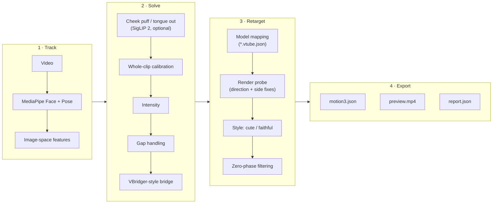

<div align="center">


<p><strong>Turn a recorded video of a person into a Live2D Cubism motion, offline.</strong></p>

<p>
<a href="https://github.com/FMsongX2/video2live2d/actions/workflows/ci.yml"></a>
<a href="LICENSE"></a>


</p>

<p><strong>English</strong> · <a href="README.ko.md">한국어</a> · <a href="README.ja.md">日本語</a> · <a href="README.zh-CN.md">简体中文</a></p>

</div>

video2live2d (V2L) reads a video of a real person with the face and shoulders in frame and writes a Cubism `.motion3.json` for a VBridger-compatible Live2D model. There is no iPhone and no live tracking: you record a clip, run one command, and get a motion that VTube Studio or any Cubism runtime can play. The product is called V2L; the Python package and the command are `v2l`.

## Highlights

- **Video in, motion out.** Head and body angles, eyes and gaze, brows, the VBridger mouth set, shoulders and breathing from an ordinary recorded clip.
- **Automatic calibration.** The least-active window of the clip becomes the rest face, which replaces VBridger's manual Calibrate button. You can also set the window yourself.
- **Uses your model's own setup.** Parameter ranges, clamps and breathing come from the model's `*.vtube.json` VTube Studio settings when present; otherwise standard Cubism parameter ids are used.
- **Rig-independent direction check.** A headless render probe measures what each parameter does on screen and fixes reversed directions and swapped eye sides. The result is cached per model.
- **SnenkBridge-format bridges.** The built-in VBridger-style bridge is evaluated by a safe interpreter of the SnenkBridge formula language, and `--bridge FILE` loads other presets in that format.
- **Two styles.** `cute` (default) adds a slightly happier, livelier performance; `faithful` adds nothing.
- **Everything is tunable.** 67 settings in 10 sections (input, calibration, intensity, smoothing, style and more) come from one schema shared by the CLI, V2L Studio and the MCP server. Built-in and user presets bundle them.
- **Agent-ready.** One JSON result object with `--json`, JSON-lines progress with `--progress json`, documented exit codes, and an MCP server for AI agents.
- **Motion editing.** Keyframes with Linear, Bezier, Stepped or Inverse stepped per segment, Bezier handles, refit and undo, in V2L Studio's curve editor or through `v2l motion` operations.
- **Mapping editing in three layers.** Modeled on VBridger, SnenkBridge and VTube Studio's parameter settings: input curves; bridge outputs with formulas, SnenkBridge-style delay buffers and VBridger-style modifiers (delay, smoothing, steps); and per-parameter mapping with ranges, invert, clamp, response curve and smoothing cutoff.
- **Optional cheek puff and tongue out.** A zero-shot SigLIP 2 stage scores expressions that MediaPipe does not report well.
- **Preview and report.** A side-by-side preview video and a `report.json` with detection rates, blinks, range use and warnings.
- **Laptop + compute host workflow.** `bin/v2l-remote` (standard library only) runs the pipeline on another machine over SSH, and V2L Studio wraps it in a desktop app with a Live2D viewer and webcam recording.

## How it works



| Stage | Source | What it does |
|---|---|---|
| Tracking | `src/v2l/signals.py` | MediaPipe Face Landmarker (52 ARKit-named blendshapes, head transform, 478 landmarks) and Pose Landmarker (shoulders). |
| Features | `src/v2l/features.py` | Head yaw/pitch/roll, per-eye aperture, iris gaze, jaw drop, inner-lip gap, mouth width, face-local lateral mouth shift, shoulder roll/yaw/height. |
| Cheek / tongue | `src/v2l/rare.py` | Optional zero-shot scoring with SigLIP 2 on every n-th frame. |
| Calibration | `src/v2l/calibrate.py` | Finds the rest face (least-active window) and per-channel response from the whole clip. |
| Intensity | `src/v2l/calibrate.py` | Scales each movement group (head, body, gaze, brows, smile, mouth, cheek/tongue) by the `intensity.*` settings. |
| Gaps | `src/v2l/temporal.py` | Resamples to the output frame rate; gaps up to 0.4 s (`gaps.max_gap`) are interpolated, longer gaps ease to rest. |
| Bridge | `src/v2l/bridge.py`, `src/v2l/bridges/default.json` | VBridger-style outputs evaluated by a safe AST interpreter of the SnenkBridge formula language. A mapping file can patch or add outputs, with delay buffers and modifiers. |
| Mapping | `src/v2l/mapping.py`, `src/v2l/model.py` | Reuses the model's VTube Studio parameter settings; falls back to standard Cubism ids. A mapping file (`--mapping`) can change any entry or add new ones. |
| Probe | `src/v2l/render.py`, `src/v2l/web/` | Renders the model headless and fixes reversed directions and swapped eye sides. |
| Style | `src/v2l/style.py` | `cute` or `faithful`. |
| Export | `src/v2l/motion3.py`, `src/v2l/pipeline.py` | Zero-phase Butterworth filtering per parameter group, linear segments (or restricted Beziers with `output.interpolation=bezier`) simplified with Ramer-Douglas-Peucker within 0.4 % of each parameter's range, validation, preview and report. |
| Settings | `src/v2l/config.py`, `src/v2l/presets/` | The settings schema, validation and presets used by every stage. |
| Editing | `src/v2l/motionedit.py`, `src/v2l/inputs.py` | Editable motion format, edit operations, fitting and validation; the inputs a mapping may use. |

Physics output parameters are left to the runtime. Rendering for the probe and the preview uses Playwright driving an installed Google Chrome with SwiftShader (CPU rendering), because GPU WebGL backends lost the context with very large (8K) textures.

## Requirements

**Compute host** (runs `v2l`)

- Linux (x86_64 or arm64) or macOS on Apple silicon, Python 3.11 or newer. MediaPipe publishes no Intel macOS wheel.
- Google Chrome installed (Playwright launches it with `channel="chrome"`).
- No separate ffmpeg: `imageio-ffmpeg` ships a binary.
- Optional: an NVIDIA GPU for the cheek/tongue stage. It uses the GPU when at least 3 GB are free and otherwise runs on the CPU at about 0.8 s per scored frame.

**Laptop** (for the remote workflow and V2L Studio)

- V2L Studio: Node.js and npm, and `python3`. `ffmpeg` on the `PATH` is optional; Studio uses it to remux webcam takes so they seek correctly.
- Remote mode (`bin/v2l-remote`, Studio's **Remote host**, `bin/v2l-mcp`): `python3`, `rsync` and `ssh` with key-based login to the compute host.
- Local mode (Studio's **This computer**): the compute-host requirements above, on the same machine.

The compute host and the laptop can be the same machine.

## Quick start

### A. Run on the compute host

```bash
git clone https://github.com/FMsongX2/video2live2d.git
cd video2live2d
python3 -m venv .venv && source .venv/bin/activate
pip install -e .
# optional: cheek puff / tongue out (installs torch + transformers)
pip install -e '.[rare]'

v2l run clip.mp4 --model ~/Models/MyModel --name hello
```

Results land in `v2l_out/` (`hello.motion3.json`, `hello.preview.mp4`, `hello.report.json`). The motion is also copied into the model folder unless you pass `--no-install`. Tracker models and Live2D Cubism Core are downloaded on first use.

### B. Laptop + compute host

```bash
export V2L_HOST=user@gpu-box          # required, no default
export V2L_DIR=v2l                    # optional, relative to the remote home

bin/v2l-remote setup                  # push code, create .venv, install, pre-download tracker models, Cubism Core and renderer libraries
bin/v2l-remote run clip.mp4 --model ~/Models/MyModel --name hello --out ~/Downloads/v2l_out
```

`run` uploads the video and the model folder, runs `v2l run` on the host, and copies the results back to `~/Downloads/v2l_out/hello/`. The motion is then copied into your local model folder unless you pass `--no-install`. Other `v2l run` options (`--preset`, `--config`, `--set`, shortcut flags) are accepted too. Check the connection with `bin/v2l-remote check`. Run `setup` again after updating the code. To enable the cheek/tongue stage on the host, run `.venv/bin/pip install -e '.[rare]'` inside `V2L_DIR` there.

### C. V2L Studio

```bash
bin/v2l-studio
# optional: values from the environment (shown locked in Settings)
V2L_MODEL=~/Models/MyModel V2L_HOST=user@gpu-box bin/v2l-studio
```

The first launch runs `npm install` in `app/`. Generation needs a compute backend, chosen in **Settings → Compute**:

- **Remote host:** enter `user@gpu-box`, click **Test connection**, then **Set up host** (runs `bin/v2l-remote setup`).
- **This computer:** click **Set up this computer** (creates `.venv` in the repository and installs V2L into it), or install it yourself with `pip install -e .` inside `.venv` as in A.

Environment variables such as `V2L_HOST` and `V2L_MODEL` still work and lock the matching setting.

## Usage reference

### `v2l run`

```text
v2l run VIDEO --model DIR --name NAME [--out DIR] [--preset NAME|FILE] [--config FILE]...
        [--set SECTION.NAME=VALUE]... [shortcut flags] [--mapping FILE] [--dump-signals]
        [--no-install] [--dry-run] [--json] [--progress text|json]
```

Settings are applied in this order, later ones winning:

**defaults < `--preset` < `--config` files (in order) < shortcut flags < `--set` (in order)**

<details>
<summary>All options</summary>

| Option | Default | Meaning |
|---|---|---|
| `--model DIR` | required | Live2D model folder (`*.model3.json`, optional `*.vtube.json`). |
| `--name NAME` | required | Output name; the motion is `NAME.motion3.json`. |
| `--out DIR` | `v2l_out` | Output folder; files are written directly into it. |
| `--preset NAME\|FILE` | none | A built-in or user preset, or a preset file (see [Settings & presets](#settings--presets)). |
| `--config FILE` | none | A JSON configuration file. Repeatable; later files win. |
| `--set SECTION.NAME=VALUE` | none | One setting, e.g. `intensity.smile=1.5` or `calibration.neutral_window=2:3`. Repeatable; applied last. |
| `--mapping FILE` | none | A mapping file (see [Editing motions and mappings](#editing-motions-and-mappings)). |
| `--dump-signals` | off | Also write `NAME.signals.json`: tracking inputs and bridge outputs per frame. |
| `--no-install` | off | Do not copy the motion into the model folder. |
| `--dry-run` | off | Check the inputs and settings and print the planned output files and the effective settings. No tracking. |
| `--json` | off | Print exactly one JSON result object on stdout; everything else goes to stderr. |
| `--progress text\|json` | `text` | `json`: every stderr line is a JSON event (see below). |

</details>

<details>
<summary>Shortcut flags (each sets one setting)</summary>

| Flag | Setting | Meaning |
|---|---|---|
| `--style cute\|faithful` | `style.name` | `cute` (default) adds a happier rest face, eye smile and blush with smiles, slightly larger resting eyes, a little more head motion, and sparkle eyes on long big smiles if the model has `ParamEyeSparkle`. `faithful` adds nothing. |
| `--fps N` | `output.fps` | Output frame rate (default 30). |
| `--fade S` | `output.fade` | Fade-in/fade-out time in seconds (default 0.5). |
| `--loop` | `output.loop=true` | Make the motion loop seamlessly (for idle animations). |
| `--flip` | `input.flip=true` | The input was recorded mirrored (selfie camera). |
| `--start S`, `--end S` | `input.start`, `input.end` | Use only part of the clip (seconds). |
| `--neutral A:B` | `calibration.neutral_window` | Rest-face window in seconds, relative to `--start`. Default: found automatically. |
| `--bridge NAME\|FILE` | `bridge.preset` | Built-in bridge preset name (default `default`) or a SnenkBridge-format JSON file: a plain parameter list or a `snek` preset, including `delayBuffer` outputs. |
| `--no-preview` | `preview.enabled=false` | Skip the preview video. |
| `--no-rare` | `expressions.enabled=false` | Skip the cheek-puff / tongue-out stage. |
| `--rare-stride N` | `expressions.stride` | Score cheek puff / tongue out on every N-th frame (default 3). |

</details>

**Curve interpolation.** `output.interpolation` is `linear` by default. `--set output.interpolation=bezier` writes restricted Bezier segments: about half the keys and smoother to edit, but each Bezier segment counts three points, so the file is larger.

**JSON result** (`--json`):

```text
{"ok": true, "name": "hello", "out_dir": "...", "files": {"motion": "...", "report": "...", "preview": "..." | null},
 "installed": "..." | null, "summary": {...}}
{"ok": false, "error": {"type": "...", "message": "..."}}
```

With `--dry-run` the result has `"dry_run": true` and `"settings"` instead of `"summary"`.

**Progress events** (`--progress json`, one JSON object per stderr line):

| Event | Fields |
|---|---|
| `stage` | `stage`: one of `probe`, `tracking`, `expressions`, `solving`, `writing`, `preview` (`v2l-remote` adds `upload` first and `download` last). |
| `progress` | `stage`, `done`, `total`; about every 0.5 s, and always the final count. |
| `log` | `message`; tracker and library output is wrapped into these. |

**Exit codes** (the same for `v2l` and `v2l-remote`):

| Code | Error types |
|---|---|
| `0` | success |
| `1` | `runtime`, `remote` |
| `2` | `usage`, `config`, `input`, `invalid` (a motion, edit operation, mapping or formula that does not validate) |
| `3` | `unusable_input`: the video does not open, or no face is tracked |
| `4` | `remote_unreachable`: the compute host cannot be reached |
| `130` | `interrupted`, `cancelled` |

### Other `v2l` commands

| Command | What it does |
|---|---|
| `v2l probe --model DIR [--details] [--json]` | Reads the model's parameter ranges and measures screen directions (cached per model). `--details` adds the measured effect of every probed parameter. |
| `v2l presets list [--json]` | Built-in and user presets. |
| `v2l presets show NAME\|FILE` | A preset's settings as JSON. |
| `v2l presets save NAME FILE` | Validate `FILE` and save it as user preset `NAME`. |
| `v2l config schema` | Every setting with type, default, range, unit, help and `affects`, as JSON. |
| `v2l config defaults` | The default configuration as JSON. |
| `v2l config presets` | Built-in and user presets as JSON. |
| `v2l config validate FILE...` | Check configuration files and print the merged result. |
| `v2l version [--json]` | The V2L version. |
| `v2l motion info\|read\|write\|edit\|refit\|eval\|validate ...` | Inspect, convert, edit, refit, sample and validate motion files. |
| `v2l mapping show\|inputs\|validate ...` | A model's effective mapping with the source of each value, the inputs a mapping can use, and mapping-file validation. |
| `v2l bridge show\|check\|validate ...` | The effective bridge outputs, a check of one formula, and validation of a SnenkBridge preset or a mapping's bridge section. |
| `v2l mcp [...]` | The MCP server (see [Agents](#agents-mcp--cli)). |

`v2l config`, `v2l presets`, `v2l version`, `v2l motion`, `v2l bridge` and `v2l mapping inputs|validate` (without `--model`) need only the standard library. Formats and every option: [docs/motion-editing.md](docs/motion-editing.md).

### `bin/v2l-remote`

| Command | What it does |
|---|---|
| `setup` | Push code to `V2L_HOST`, create `.venv`, `pip install -e '.[test]'`, pre-download tracker models, Cubism Core and the renderer libraries. |
| `run VIDEO --model DIR --name NAME [--out DIR] [--no-install] [--json] [--progress text\|json] [v2l run options...]` | Run `v2l run` on the host and copy the results to `OUT/NAME/` (`--out` defaults to `V2L_OUT`, else `~/Downloads/v2l_out`). |
| `probe --model DIR [--details] [--json]` | Probe a local model on the host. |
| `mapping show --model DIR [--mapping FILE] [--json]` | Compute a local model's effective mapping on the host. |
| `mapping inputs\|validate ...`, `bridge ...` | Run on the laptop; `V2L_HOST` is not needed. |
| `check [--json]` | Is the host reachable, and is V2L installed there? |
| `version [--json]` | Version of the local V2L code. |
| `test` | Run the unit tests on the host. |
| `regress` | Run the regression harness on the host with the model in `V2L_REGRESS_MODEL`. |

How `v2l-remote run` handles settings and jobs:

- `--preset`, `--config` files, shortcut flags and `--set` are resolved **on the laptop**, so your user presets and local files are used. One file with the effective settings is uploaded per run (plus a local bridge file, if any) and removed afterwards. Invalid settings fail before anything is uploaded.
- `--dry-run` runs on the laptop without connecting.
- `--mapping FILE` is uploaded like the settings file and removed after the run; with `--dump-signals` the signals file comes back with the results.
- Stopping `v2l-remote` (Ctrl-C, SIGTERM or SIGHUP) also stops the job on the host and removes that run's files there; it exits with 130.

### Environment variables

| Variable | Used by | Meaning |
|---|---|---|
| `V2L_HOST` | `v2l-remote`, Studio, MCP server | SSH destination of the compute host, e.g. `user@gpu-box`. Required for `v2l-remote`; no default. For the MCP server it switches on remote mode. |
| `V2L_DIR` | `v2l-remote`, Studio, MCP server (remote mode) | Working directory on the host. Default `v2l`, relative to the remote home. |
| `V2L_OUT` | `v2l-remote`, Studio, MCP server | Output folder (default of `v2l-remote run --out`). Default `~/Downloads/v2l_out`. |
| `V2L_MODEL` | Studio | Model folder to open at start. Optional. |
| `V2L_CUBISM_CORE` | `v2l` | Path to a local `live2dcubismcore.min.js` instead of downloading it. |
| `V2L_REGRESS_MODEL` | `v2l-remote regress` | Model folder for the regression run. Required for `regress`. |
| `XDG_CONFIG_HOME` | `v2l`, `v2l-remote`, MCP server | User presets live in `$XDG_CONFIG_HOME/v2l/presets` (default `~/.config/v2l/presets`). |

## Settings & presets

Every tunable value lives in one schema, `src/v2l/config.py`: 67 settings in 10 sections. The CLI, V2L Studio and the MCP server read the same schema, so a setting has the same name, range and meaning everywhere. Unknown keys, wrong types and out-of-range values are errors.

| Section | What it controls | Example keys |
|---|---|---|
| `input` | Which part of the video is used and how it is read. | `start`, `end`, `flip` |
| `output` | Frame rate, fades, looping and file size of the motion. | `fps`, `loop`, `interpolation` |
| `calibration` | How the rest face and the full range of each expression are estimated. | `neutral_window`, `jaw_full`, `gaze_full` |
| `intensity` | Overall strength of each group of movements. | `head`, `smile`, `mouth_open` |
| `gaps` | What happens when the face is lost for a moment. | `max_gap`, `ramp` |
| `expressions` | The optional cheek-puff / tongue-out stage. | `enabled`, `stride`, `cheek_thresholds` |
| `bridge` | VBridger-style formulas from tracking inputs to bridge outputs. | `preset` |
| `style` | Performance style added on top of the tracked motion. | `name`, `blush_smile`, `head_gain` |
| `filtering` | Zero-phase low-pass filtering per parameter group. | `cutoff_scale`, `head`, `mouth` |
| `preview` | The side-by-side preview video. | `enabled`, `width`, `height` |

<details>
<summary>All setting names by section</summary>

| Section | Settings |
|---|---|
| `input` | `start`, `end`, `flip`, `analysis_width` |
| `output` | `fps`, `fade`, `loop`, `loop_blend`, `breath_period`, `interpolation`, `tolerance` |
| `calibration` | `neutral_window`, `neutral_seconds`, `rest_head_range`, `full_percentile`, `min_span`, `max_gain`, `blink_deadzone`, `blink_landmark_weight`, `eye_closed_ratio`, `eye_wide_range`, `jaw_full`, `lip_gap_full`, `mouth_narrow_full`, `mouth_wide_full`, `mouth_shift_full`, `gaze_full` |
| `intensity` | `head`, `body`, `gaze`, `brows`, `smile`, `mouth_open`, `mouth_shape`, `cheek_tongue` |
| `gaps` | `max_gap`, `ramp` |
| `expressions` | `enabled`, `stride`, `cheek_thresholds`, `tongue_thresholds` |
| `bridge` | `preset` |
| `style` | `name`, `mouth_form_bias`, `eye_smile_max`, `blush_rest`, `blush_smile`, `eye_open_scale`, `head_gain`, `sparkle_param`, `sparkle_smile`, `sparkle_hold` |
| `filtering` | `despike`, `cutoff_scale`, `head`, `body`, `eyeball`, `eye_open`, `brows`, `smile`, `mouth`, `blush`, `sparkle`, `other` |
| `preview` | `enabled`, `width`, `height` |

</details>

For types, defaults, ranges, units and help text, run `v2l config schema` (or `python -m v2l.config schema`, which needs only the standard library).

**What a change affects.** Each setting has an `affects` value:

- `tracking`: the video is tracked again (`input.*`, `expressions.enabled`, `expressions.stride`).
- `solve`: cached tracking is reused and only the motion is recomputed (most settings). The tracking cache lives in `~/.cache/v2l` on the machine that runs `v2l`, so re-running a clip with different solve settings skips tracking.
- `output`: only the preview rendering changes (`preview.*`).

**Built-in presets**

| Preset | Description |
|---|---|
| `default` | V2L defaults: cute style, automatic rest face, standard smoothing. |
| `faithful` | Only what the camera sees: no added smile, blush, eye or head styling. |
| `calm` | Smaller, smoother head and body motion for talking, reading or ASMR-style clips. |
| `lively` | Bigger head, body and facial movement for energetic clips. |
| `idle_loop` | A seamless idle animation: looping, whole breathing cycles and gentle smoothing. |

User presets live in `$XDG_CONFIG_HOME/v2l/presets` (default `~/.config/v2l/presets`); a user preset with a built-in's name replaces it. A preset is a configuration file with an optional `meta` block:

```json
{
  "version": 1,
  "meta": {"name": "Talk show", "description": "Calmer head, stronger smile."},
  "intensity": {"head": 0.8, "smile": 1.3},
  "filtering": {"cutoff_scale": 0.8}
}
```

```bash
v2l config validate talk_show.json
v2l presets save talk_show talk_show.json
v2l run clip.mp4 --model ~/Models/MyModel --name hello --preset talk_show --set intensity.smile=1.5
```

## Editing motions and mappings

Motions and mappings stay editable after generation, from the CLI, the MCP server and V2L Studio. [docs/motion-editing.md](docs/motion-editing.md) is the full specification: file formats, every operation, the formula syntax and all command options.

### Motions

Motions are ordinary `.motion3.json` files. Each segment between two keys is Linear, Bezier, Stepped or Inverse stepped. V2L writes **restricted Beziers** (`AreBeziersRestricted`): the two control points sit at one third and two thirds of the segment's time span, so the value is a cubic polynomial in time and every Cubism runtime evaluates it the same way. Editors change only the control values. Beziers from other tools are read exactly and converted only when that segment is edited.

`v2l motion read` gives an editable JSON (keys, the type of each segment, handles). `v2l motion edit` applies a list of operations in order: insert, move and delete keys, set interpolation and handles, automatic or flat tangents, refit, scale, offset, clamp, retime, trim and timing. An invalid operation is reported with its index and nothing is written; an existing output file is replaced only with `--overwrite`.

```json
[
  {"op": "insert_key", "curve": "ParamAngleX", "t": 1.0, "value": 12},
  {"op": "set_interpolation", "curves": ["ParamAngleX"], "type": "bezier", "from": 0.5, "to": 2.0},
  {"op": "refit", "curves": "*", "tolerance": 0.004, "interpolation": "bezier"},
  {"op": "trim", "from": 1.0, "to": 13.0}
]
```

```bash
v2l motion read hello.motion3.json --json                # editable JSON: keys, segment types, handles
v2l motion edit hello.motion3.json --ops ops.json --out hello_edit.motion3.json --json
v2l motion refit hello.motion3.json --interpolation bezier --tolerance 0.004 --out hello_bezier.motion3.json
```

### Mappings

A mapping file (`--mapping FILE`) changes, per model, how tracking reaches the Live2D parameters. It has three layers, applied in this order after tracking:

| Layer | Modeled on | What it changes |
|---|---|---|
| `input_curves` | VBridger's input curves | Reshape a tracking input, e.g. let an eye that never opens fully reach 1. |
| `bridge` | SnenkBridge presets, VBridger modifiers | Patch, add or disable bridge outputs: formulas, SnenkBridge-style `delayBuffer`, and the modifiers `delayMs`, `smoothing` and `steps`. |
| `entries` | VTube Studio parameter settings | Per Live2D parameter: input, input and output ranges, invert, clamps, response curve, smoothing cutoff, breathing, on or off. |

```json
{
  "format": "v2l.mapping",
  "version": 1,
  "input_curves": {"EyeWideLeft": {"points": [[0, 0], [0.6, 1], [1, 1]], "smooth": true}},
  "bridge": [
    {"name": "MouthOpen", "modifiers": {"smoothing": 0.2}},
    {"name": "EarSwing", "func": "", "min": -1, "max": 1, "defaultValue": 0,
     "delayBuffer": {"refParam": "FaceAngleX", "smoothing": 3, "delayCount": 8,
                     "inMin": -20, "inMax": 20, "outMin": -1, "outMax": 1}}
  ],
  "entries": [
    {"output": "ParamAngleX", "in": [-25, 25], "out": [-30, 30], "cutoff": 2.0},
    {"output": "ParamEarL", "input": "EarSwing"},
    {"output": "ParamBodyAngleZ", "enabled": false}
  ]
}
```

```bash
v2l mapping inputs --json                               # input names, meaning, nominal range
v2l mapping show --model ~/Models/MyModel --mapping MyModel.json
v2l bridge check --func "0.5 + 0.5 * (MouthSmileLeft + MouthSmileRight)"
v2l run clip.mp4 --model ~/Models/MyModel --name hello --mapping MyModel.json --dump-signals
```

Only what you change is stored; everything else comes from the model's `*.vtube.json` or the standard mapping, with the render probe's direction fixes. Formulas use SnenkBridge's syntax, with the differences listed in the specification. The layers apply after tracking, so a changed mapping reuses the tracking cache. `--dump-signals` writes `NAME.signals.json` with the inputs and bridge outputs per frame, so you can plot what the mapping sees.

### In V2L Studio

The motion editor and the mapping editor (see [V2L Studio](#v2l-studio)) work on the same formats and call the same operations.

<p align="center"></p>

<p align="center">


</p>

## Agents (MCP & CLI)

V2L can be driven by AI agents in two ways: the CLI with `--json` and `--progress json`, or an [MCP](https://modelcontextprotocol.io/) server over stdio. For coding agents that already run shell commands, the CLI is the lighter option. The MCP server suits chat and desktop clients.

**Install**

- Local mode (tracking runs on this machine): `pip install -e '.[mcp]'`, then run `v2l mcp`.
- Remote mode (on a laptop, jobs run on `V2L_HOST` through `v2l-remote`): use `bin/v2l-mcp`. It needs only `python3`, `rsync`, `ssh` and the `mcp` package; if `mcp` is missing, [uv](https://docs.astral.sh/uv/) supplies it.

The server runs in remote mode whenever `V2L_HOST` is set.

**Register it with a client** (replace `/abs/path` and `user@gpu-box` with your own):

```bash
# local mode
claude mcp add v2l -- /abs/path/video2live2d/.venv/bin/v2l mcp
# remote mode
claude mcp add v2l -e V2L_HOST=user@gpu-box -e V2L_DIR=v2l -- /abs/path/video2live2d/bin/v2l-mcp
codex mcp add v2l --env V2L_HOST=user@gpu-box --env V2L_DIR=v2l -- /abs/path/video2live2d/bin/v2l-mcp
```

Clients configured with JSON:

```json
{
  "mcpServers": {
    "v2l": {
      "command": "/abs/path/video2live2d/bin/v2l-mcp",
      "env": {"V2L_HOST": "user@gpu-box", "V2L_DIR": "v2l", "V2L_OUT": "/Users/me/Downloads/v2l_out"}
    }
  }
}
```

**Tools**

| Tool | What it does |
|---|---|
| `v2l_params(section?)` | The settings schema, the defaults and the presets, optionally for one section. |
| `v2l_validate_settings(settings?, preset?)` | Dry run of the settings only: apply a preset and partial settings and check them. |
| `v2l_probe_model(model, details?)` | Probe a model's parameters and screen directions. |
| `v2l_list_motions(model)` | The `*.motion3.json` files in a model folder. |
| `v2l_mapping_get(model, mapping?)` | A model's effective mapping (all three layers) and the available inputs. |
| `v2l_bridge_check(func, mapping?)` | Check one bridge formula: names read, unknown names, error position. |
| `v2l_motion_info(motion)` | Curves, segment types, counts and problems of a motion. |
| `v2l_motion_read(motion, curves?)` | A motion as editable JSON. |
| `v2l_motion_edit(motion, operations, out, overwrite?, ranges?)` | Apply edit operations and write the result as a new motion. |
| `v2l_generate(video, model, name, preset?, settings?, mapping?, preview?, out_dir?, install?, job?, wait_seconds?)` | Start or resume a generation job. |
| `v2l_job_status(job, wait_seconds?)` | Wait for a job and return its progress or result. |
| `v2l_jobs()` | All known jobs. |
| `v2l_job_cancel(job)` | Stop a queued or running job (in remote mode, the process on the host too). |
| `v2l_install_motion(motion, model, overwrite?)` | Copy a motion into a model folder (only with the `install` toolset). |

**Long jobs.** `v2l_generate` waits up to 45 s (default 40 s, below the 60 s request timeout of common clients) while sending progress notifications, then returns either the result or a job handle. Call `v2l_job_status` with the handle to keep waiting. Sending the same request again (same video and model content, settings, name and output folder) resumes the same job instead of starting a second run. Jobs run one at a time; later ones are `queued`. Job records are kept in `~/.cache/v2l/jobs/`.

**Server flags**

| Flag | Meaning |
|---|---|
| `--read-only` | Hide the tools that generate, cancel or install motions. |
| `--toolsets inspect,generate,install` | Enabled tool groups (default `inspect,generate`). |
| `--allow-dir DIR` | Every path argument must lie inside one of these folders (repeatable). The output folder is always allowed for outputs. |

**Safety**

- The compute host comes only from `V2L_HOST` / `V2L_DIR`, never from a tool argument.
- Paths must be absolute or start with `~`; names match `^[A-Za-z0-9_-]{1,80}$`.
- Installing into a model folder is off by default: `install=true` is refused unless the `install` toolset is enabled.
- An existing `<out>/<name>/` is never overwritten. A failed or cancelled job removes its own output folder, so a retry can reuse the name.
- `v2l_motion_edit` writes only inside the output folder or `--allow-dir` folders, into a model folder only with the `install` toolset, and is hidden with `--read-only`.

**GUI clients and `PATH`.** Desktop apps often start with a minimal `PATH`, so `v2l`, `uv`, `rsync` or `ssh` may not be found. Use absolute paths in the client configuration, and make sure the tools `bin/v2l-mcp` needs are in standard locations. Started from a terminal, the server prints a note that it is waiting for an MCP client; that is not a hang.

## V2L Studio

<p align="center">


</p>

V2L Studio (`bin/v2l-studio`) is an Electron desktop app with a Live2D viewer on one side and a creation panel on the other.

- **Viewer.** Framing presets, drag and zoom, a physics toggle and a scrub bar. **Space** toggles playback. Textures are shown through a viewing copy capped at 4K; the model folder is not modified.
- **Creation panel.** Pick or drop a video, or record a webcam take. Set the motion name, the tuning preset and the style, and optionally trim, the neutral window, cheek/tongue recognition and mirroring. The ⋯ menu saves these as defaults, resets them, or copies the run as a `v2l run` command.
- **Generation.** A numbered stage list (upload, probe, tracking, expressions, solving, writing, preview, download) with frame progress for tracking and expression scoring; the raw log stays available. Failures are named (no usable face, host unreachable, invalid settings, cancelled), and cancelling asks for confirmation. A finished result can be compared with the source video in sync, saved into the model folder (asking before overwriting), loaded back with **Use these settings**, or regenerated with **Run again with current settings** under a numbered name.
- **Motion editor.** **Edit motion** (next to the motion list, or on a result) opens a curve editor docked under the viewer; the viewer and the source video follow the playhead. Select, drag and insert keys, edit Bezier handles, switch segments between Linear, Bezier, Stepped and Inverse stepped, apply Auto or Flatten, and refit, scale, trim or retime in the inspector. Undo and redo cover every change, and a popover lists the keyboard and mouse shortcuts. Save as a new motion, overwrite (after a confirmation), or save into the model folder.
- **Mapping editor.** **Mapping** on the model header, or **Parameter mapping** in Settings → Generation defaults, opens the three layers as tabs: Inputs, Bridge outputs and Parameters. **Preview changes** regenerates the last result with the unsaved mapping, reusing its tracking, and plays it; **Keep** or **Discard** decides whether that result stays. Saved mappings are passed to every later run.
- **Webcam takes.** A 3-2-1 countdown and a neutral-face cue that becomes the rest window. Takes last 2.3 to 60 seconds; the microphone is opt-in. Takes are saved under `<V2L_OUT>/recordings/`.
- **Languages and themes.** English, Korean, Japanese and Simplified Chinese; System, Light or Dark theme. Neutral colors come from Adobe Spectrum 2; the accent is coral (`#FD7688`) in the light theme and Spectrum magenta in the dark theme.

### Settings window

Open it with the gear button, the app menu, or ⌘, (Ctrl+, on Linux). The search field filters every setting by label, help text and key.

| Section | What it holds |
|---|---|
| General | Language, theme (System / Light / Dark), default model folder, open the last model on start. |
| Compute | **Remote host** (host, remote directory, **Test connection**, **Set up host**) or **This computer** (path of the `v2l` executable, **Test**, **Set up this computer**). |
| Output | Output folder, what to do when a result name exists, automatic save to the model folder (off by default), preview video (off by default in Studio). |
| Generation defaults | Default preset, style, loop, mirroring, cheek/tongue and stride, frame rate, fade, bridge preset, curve interpolation, parameter mapping. |
| Tuning | Every setting of the schema, grouped as in [Settings & presets](#settings--presets). Advanced fields sit behind a toggle, each field and group can be reset, and fields that change tracking carry a "re-tracks the video" badge. |
| Presets | Built-in and user presets, shared with the CLI: apply, save the current tuning, rename, delete, import, export. |
| Viewer | Defaults for physics, 4K textures, framing, loop and sync. |
| Camera | Default camera and whether to record audio. |
| Agents & CLI | Copyable `claude mcp add` and `codex mcp add` commands and client JSON for the MCP server, plus the current settings as one `v2l run` command, filled in with your executable, host and output folder. |
| Advanced | Log filter, clear the model cache, export and import all settings, reset everything. |
| About | Versions, licenses, third-party notices, copyable diagnostics without paths or host names. |

<p align="center"></p>

**Persistence.** Changes are saved immediately to `settings.json` in the app's data folder (`v2l-studio`); only values that differ from the defaults are stored. Precedence: schema default < Studio settings < environment variable < per-run value in the creation panel. Values set by an environment variable (`V2L_HOST`, `V2L_DIR`, `V2L_OUT`, `V2L_MODEL`) are shown locked.

**What runs where.** The viewer, recording and file handling run on the laptop. Tracking, solving and probing run on the remote host (through `bin/v2l-remote`) or on this computer (through the local `v2l`), as chosen in Settings → Compute. Until compute is set up, the connection button reads **Set up generation** and opens Settings → Compute.

## Output files

For `--name hello`, `v2l run` writes these files directly into its `--out` folder (default `v2l_out/`); `bin/v2l-remote run` and Studio write them into `<out>/hello/` (default `~/Downloads/v2l_out/hello/`):

| File | Content |
|---|---|
| `hello.motion3.json` | The Cubism motion: linear segments by default (restricted Beziers with `output.interpolation=bezier`), simplified and validated. |
| `hello.preview.mp4` | Source video next to the rendered model with physics on (skipped with `--no-preview`). |
| `hello.report.json` | Face and pose detection rates, the longest tracking gap, the rest window used, blinks, per-parameter range use, the effective mapping, mapping notes and warnings. |
| `hello.signals.json` | Tracking inputs and bridge outputs per frame (only with `--dump-signals`). |

By default the motion is also copied into the model folder. VTube Studio then lists it as an animation for that model.

## Recording tips

- Keep the face lit and fully visible, with the shoulders in frame.
- Hold a neutral face for about one second at the start, then pass `--neutral 0:1`.
- Exaggerate a little. The avatar shows only what the camera sees.
- If the footage was recorded mirrored (selfie camera), pass `--flip`.
- Use `--start` and `--end` to cut setup time at the beginning and end of a take.

## Limitations

- V2L is not a numerical reproduction of iPhone ARKit or VBridger. Calibration is estimated from the video, and a compatible bridge preset does not make the output equivalent to VBridger's.
- Some MediaPipe blendshape channels are weak or noisy; V2L combines them with landmark geometry, but subtle mouth and brow shapes can be under- or over-estimated.
- Cheek puff and tongue out are experimental. They were measured only on a small internal set of 10 annotated clips (frame AUC 0.98 for cheek puff and 0.996 for tongue out, versus 0.07 for MediaPipe's `cheekPuff`), which is not distributed.
- Arms and hands move only if the rig drives them, usually through physics. They do not copy the performer's arm pose.
- Offline only: there is no live tracking mode.
- One performer per clip.
- Parameters that a mapping file adds are not measured by the render probe, so their direction is not corrected automatically.

## Development

```bash
pip install -e '.[test,mcp]'
pytest
```

The tests cover calibration, the bridge language, mapping, gaps, motion3 export, the CLI and the MCP server; the MCP tests use a fake CLI and no network. Without the `mcp` extra, the tests that need the MCP SDK are skipped.

**Regression harness.** `regression/run.py` runs the pipeline over your own clips and writes `regression/results/summary.json` plus a contact sheet per clip. Clips are not distributed. List them in `regression/videos/manifest.json`:

```json
[
  {"id": "talk_front", "file": "talk_front.mp4", "conditions": ["frontal", "speech"]},
  {"id": "turn_dim", "file": "turn_dim.mp4", "conditions": ["head turn", "low light"]}
]
```

`file` is relative to `regression/videos/`. Run it with:

```bash
python regression/run.py --model /path/to/model [--style cute] [--config FILE]
# or from the laptop:
V2L_REGRESS_MODEL=/path/to/model bin/v2l-remote regress
```

**Research.** `research/rare_expr.py` reproduces the cheek-puff / tongue-out measurement on your own annotated clips listed in `regression/expressions/manifest.json`.

**CI.** The [CI workflow](.github/workflows/ci.yml) installs `.[test,mcp]`, runs `pytest` on Python 3.12 and syntax-checks the JavaScript.

Tested on Ubuntu 24.04 x86_64 with Python 3.12 as the compute host (the cheek/tongue stage on both GPU and CPU), and on macOS (Apple silicon) with Python 3.14 for a local `v2l run` and for Studio.

## Third-party components & licenses

V2L's own code is MIT-licensed ([LICENSE](LICENSE)). Apart from 21 Lucide icons inlined in V2L Studio, third-party files are installed by package managers or downloaded on first use and are not included in this repository:

| Component | License |
|---|---|
| Live2D Cubism Core for Web | Live2D Proprietary Software License (downloaded from Live2D's site) |
| pixi.js 6.5.10 | MIT |
| pixi-live2d-display 0.4.0 (`cubism4.min.js`) | MIT; bundles the Cubism Framework under the Live2D Open Software License |
| MediaPipe Face / Pose Landmarker models | Apache-2.0 |
| SigLIP 2 (`google/siglip2-so400m-patch14-384`) | Apache-2.0 |
| [Lucide](https://lucide.dev) icons (21, inlined in V2L Studio) | ISC; seven are derived from Feather (MIT) |

The pixi files are pinned by SHA-256 in `src/v2l/web/assets.json`. See [THIRD_PARTY_NOTICES.md](THIRD_PARTY_NOTICES.md) for details. No third-party bridge presets are included.

**Your responsibilities.**

- Publishing works made with Live2D models may require Live2D's own licenses (for example the Live2D Publication License). Check Live2D's terms for your case.
- You need the rights to the models you animate.
- You need the consent of the people in the videos you process.

## Acknowledgements

- [MediaPipe](https://github.com/google-ai-edge/mediapipe) for face and pose tracking.
- [pixi-live2d-display](https://github.com/guansss/pixi-live2d-display) and [PixiJS](https://github.com/pixijs/pixijs) for rendering.
- [Live2D Cubism](https://www.live2d.com/) for the model format and runtime.
- [Lucide](https://lucide.dev) for V2L Studio's icons, and [Adobe Spectrum 2](https://spectrum.adobe.com/) for the design tokens behind its themes.
- The [SnenkBridge](https://github.com/FaeyUmbrea/SnenkBridge) formula language, which the bridge interpreter implements, and its delay buffers; a reference for the mapping editor.
- [VBridger](https://store.steampowered.com/app/1898830/VBridger/), whose workflow V2L uses as its reference, and whose input curves and modifiers the mapping editor follows.
- [SandoitchiBridge](https://github.com/an1by/SandoitchiBridge), whose transformation configs informed the mapping file.

## License

[MIT](LICENSE)
