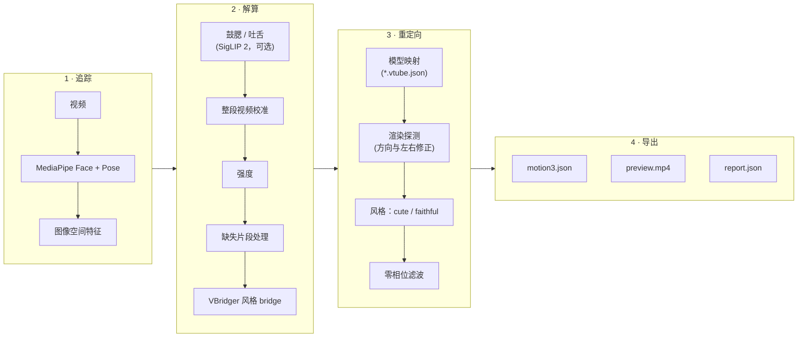

<div align="center">


<p><strong>离线将真人录制视频转换为 Live2D Cubism 动作。</strong></p>

<p>
<a href="https://github.com/FMsongX2/video2live2d/actions/workflows/ci.yml"></a>
<a href="LICENSE"></a>


</p>

<p><a href="README.md">English</a> · <a href="README.ko.md">한국어</a> · <a href="README.ja.md">日本語</a> · <strong>简体中文</strong></p>

</div>

video2live2d（V2L）读取一段拍到真人面部和双肩的视频，为兼容 VBridger 的 Live2D 模型生成 Cubism `.motion3.json`。不需要 iPhone，也不需要实时追踪：录一段视频，运行一条命令，即可得到可在 VTube Studio 或任何 Cubism 运行时中播放的动作。产品名称为 V2L；Python 包和命令的名称为 `v2l`。

## 亮点

- **输入视频，输出动作。** 从普通录制的视频中生成头部和身体角度、眼睛与视线、眉毛、VBridger 嘴部参数组、肩膀和呼吸。
- **自动校准。** 以视频中活动最少的片段作为静止表情，替代 VBridger 的手动 Calibrate 按钮；也可以自行指定该片段。
- **沿用模型自身的设置。** 如果模型有 `*.vtube.json`（VTube Studio 设置），参数范围、限幅和呼吸设置取自该文件；否则使用标准 Cubism 参数 ID。
- **与绑定无关的方向检查。** 无头渲染探测会测量每个参数在屏幕上的实际效果，修正方向相反和左右眼对调的问题。结果按模型缓存。
- **SnenkBridge 格式的 bridge。** 内置的 VBridger 风格 bridge 由 SnenkBridge 公式语言的安全解释器求值，`--bridge FILE` 可加载同一格式的其他预设。
- **两种风格。** `cute`（默认）加入稍显开朗、生动的表演；`faithful` 不做任何添加。
- **一切皆可调。** 输入、校准、强度、平滑、风格等 10 个分区共 66 项设置，来自 CLI、V2L Studio 和 MCP 服务器共用的同一模式；可通过内置预设和用户预设组合使用。
- **面向智能体。** `--json` 输出单个 JSON 结果对象，`--progress json` 输出 JSON Lines 进度事件，退出码有文档说明，并提供面向 AI 智能体的 MCP 服务器。
- **可选：鼓腮和吐舌。** 零样本 SigLIP 2 阶段为 MediaPipe 难以识别的表情打分。
- **预览与报告。** 原视频与模型并排的预览视频，以及包含检测率、眨眼、范围使用率和警告的 `report.json`。
- **笔记本 + 计算主机工作流。** 仅依赖标准库的 `bin/v2l-remote` 通过 SSH 在另一台机器上运行流水线；V2L Studio 将其封装为带有 Live2D 查看器和摄像头录制功能的桌面应用。

## 工作原理



| 阶段 | 源文件 | 作用 |
|---|---|---|
| 追踪 | `src/v2l/signals.py` | MediaPipe Face Landmarker（52 个 ARKit 命名的 blendshape、头部变换、478 个关键点）和 Pose Landmarker（肩膀）。 |
| 特征 | `src/v2l/features.py` | 头部 yaw/pitch/roll、单眼开合度、虹膜视线、下颌张开、内唇间隙、嘴宽、以面部为基准的嘴部横向位移、肩膀 roll/yaw/高度。 |
| 鼓腮 / 吐舌 | `src/v2l/rare.py` | 可选。每 N 帧用 SigLIP 2 进行零样本打分。 |
| 校准 | `src/v2l/calibrate.py` | 从整段视频中找出静止表情（活动最少的片段）以及各通道的响应幅度。 |
| 强度 | `src/v2l/calibrate.py` | 按 `intensity.*` 设置缩放各组动作（头部、身体、视线、眉毛、微笑、嘴部、鼓腮/吐舌）。 |
| 缺失片段 | `src/v2l/temporal.py` | 重采样到输出帧率；0.4 秒（`gaps.max_gap`）以内的缺失会插值，更长的缺失平滑回到静止姿态。 |
| Bridge | `src/v2l/bridge.py`, `src/v2l/bridges/default.json` | 用 SnenkBridge 公式语言的安全 AST 解释器计算 VBridger 风格的输出。 |
| 映射 | `src/v2l/mapping.py`, `src/v2l/model.py` | 复用模型的 VTube Studio 参数设置；没有时回退到标准 Cubism ID。 |
| 探测 | `src/v2l/render.py`, `src/v2l/web/` | 无头渲染模型，修正方向相反和左右眼对调。 |
| 风格 | `src/v2l/style.py` | `cute` 或 `faithful`。 |
| 导出 | `src/v2l/motion3.py`, `src/v2l/pipeline.py` | 按参数组进行零相位 Butterworth 滤波，用 Ramer-Douglas-Peucker 在各参数范围 0.4 % 以内简化的线性分段，校验，生成预览和报告。 |
| 设置 | `src/v2l/config.py`, `src/v2l/presets/` | 各阶段共用的设置模式、校验和预设。 |

物理输出参数交由运行时处理。探测和预览的渲染由 Playwright 驱动已安装的 Google Chrome，并使用 SwiftShader（CPU 渲染），因为 GPU WebGL 后端在超大（8K）纹理下会丢失上下文。

## 环境要求

**计算主机**（运行 `v2l`）

- Linux（x86_64 或 arm64）或 Apple silicon 的 macOS，Python 3.11 及以上。MediaPipe 未发布 Intel macOS 的 wheel。
- 已安装 Google Chrome（Playwright 以 `channel="chrome"` 启动）。
- 无需另装 ffmpeg：`imageio-ffmpeg` 自带可执行文件。
- 可选：用于鼓腮/吐舌阶段的 NVIDIA GPU。空闲显存不少于 3 GB 时使用 GPU，否则在 CPU 上运行，每个打分帧约 0.8 秒。

**笔记本**（用于远程工作流和 V2L Studio）

- V2L Studio：Node.js 和 npm，以及 `python3`。`PATH` 中的 `ffmpeg` 为可选项，Studio 用它对摄像头录制进行重新封装，以便正确拖动定位。
- 远程模式（`bin/v2l-remote`、Studio 的 **远程服务器**、`bin/v2l-mcp`）：`python3`、`rsync`，以及可通过密钥登录计算主机的 `ssh`。
- 本地模式（Studio 的 **本机**）：在同一台机器上满足上述计算主机的要求。

计算主机和笔记本可以是同一台机器。

## 快速开始

### A. 在计算主机上运行

```bash
git clone https://github.com/FMsongX2/video2live2d.git
cd video2live2d
python3 -m venv .venv && source .venv/bin/activate
pip install -e .
# optional: cheek puff / tongue out (installs torch + transformers)
pip install -e '.[rare]'

v2l run clip.mp4 --model ~/Models/MyModel --name hello
```

结果保存在 `v2l_out/`（`hello.motion3.json`、`hello.preview.mp4`、`hello.report.json`）。除非传入 `--no-install`，动作还会复制到模型文件夹中。追踪模型和 Live2D Cubism Core 在首次使用时下载。

### B. 笔记本 + 计算主机

```bash
export V2L_HOST=user@gpu-box          # required, no default
export V2L_DIR=v2l                    # optional, relative to the remote home

bin/v2l-remote setup                  # push code, create .venv, install, pre-download tracker models, Cubism Core and renderer libraries
bin/v2l-remote run clip.mp4 --model ~/Models/MyModel --name hello --out ~/Downloads/v2l_out
```

`run` 会上传视频和模型文件夹，在主机上运行 `v2l run`，再把结果取回到 `~/Downloads/v2l_out/hello/`。除非传入 `--no-install`，动作还会复制到本地模型文件夹。也可使用其他 `v2l run` 选项（`--preset`、`--config`、`--set`、快捷参数）。可用 `bin/v2l-remote check` 检查连接。更新代码后请重新运行 `setup`。如需在主机上启用鼓腮/吐舌阶段，请在主机的 `V2L_DIR` 中运行 `.venv/bin/pip install -e '.[rare]'`。

### C. V2L Studio

```bash
bin/v2l-studio
# optional: values from the environment (shown locked in Settings)
V2L_MODEL=~/Models/MyModel V2L_HOST=user@gpu-box bin/v2l-studio
```

首次启动时会在 `app/` 中运行 `npm install`。生成动作需要计算环境，在 **设置 → 计算** 中选择：

- **远程主机：** 输入 `user@gpu-box`，点击 **测试连接**，然后点击 **设置服务器**（运行 `bin/v2l-remote setup`）。
- **本机：** 点击 **设置本机**（在仓库中创建 `.venv` 并安装 V2L），或像 A 中那样在 `.venv` 中用 `pip install -e .` 自行安装。

`V2L_HOST`、`V2L_MODEL` 等环境变量仍然有效，并会锁定对应的设置。

## 使用参考

### `v2l run`

```text
v2l run VIDEO --model DIR --name NAME [--out DIR] [--preset NAME|FILE] [--config FILE]...
        [--set SECTION.NAME=VALUE]... [shortcut flags] [--no-install] [--dry-run] [--json] [--progress text|json]
```

设置按以下顺序应用，后者优先：

**默认值 < `--preset` < `--config` 文件（按顺序） < 快捷参数 < `--set`（按顺序）**

<details>
<summary>全部选项</summary>

| 选项 | 默认值 | 含义 |
|---|---|---|
| `--model DIR` | 必填 | Live2D 模型文件夹（`*.model3.json`，可选 `*.vtube.json`）。 |
| `--name NAME` | 必填 | 输出名称；动作文件为 `NAME.motion3.json`。 |
| `--out DIR` | `v2l_out` | 输出文件夹；文件直接写入其中。 |
| `--preset NAME\|FILE` | 无 | 内置预设、用户预设或预设文件（见[设置与预设](#设置与预设)）。 |
| `--config FILE` | 无 | JSON 配置文件。可重复指定，后面的文件优先。 |
| `--set SECTION.NAME=VALUE` | 无 | 单个设置，例如 `intensity.smile=1.5` 或 `calibration.neutral_window=2:3`。可重复指定，最后应用。 |
| `--no-install` | 关 | 不把动作复制到模型文件夹。 |
| `--dry-run` | 关 | 检查输入和设置，输出计划生成的文件和最终设置。不进行追踪。 |
| `--json` | 关 | stdout 只输出一个 JSON 结果对象，其余内容全部输出到 stderr。 |
| `--progress text\|json` | `text` | `json`：stderr 的每一行都是 JSON 事件（见下文）。 |

</details>

<details>
<summary>快捷参数（每个对应一个设置）</summary>

| 参数 | 设置 | 含义 |
|---|---|---|
| `--style cute\|faithful` | `style.name` | `cute`（默认）加入更开朗的静止表情、笑时的眯眼笑和脸红、稍大的平时眼睛、稍多的头部动作；若模型有 `ParamEyeSparkle`，长时间大笑时会出现闪亮的眼睛。`faithful` 不做任何添加。 |
| `--fps N` | `output.fps` | 输出帧率（默认 30）。 |
| `--fade S` | `output.fade` | 淡入/淡出时间（秒，默认 0.5）。 |
| `--loop` | `output.loop=true` | 让动作无缝循环（用于待机动画）。 |
| `--flip` | `input.flip=true` | 输入是镜像录制的（自拍摄像头）。 |
| `--start S`, `--end S` | `input.start`, `input.end` | 只使用视频的一部分（秒）。 |
| `--neutral A:B` | `calibration.neutral_window` | 静止表情片段（秒），相对于 `--start`。默认自动查找。 |
| `--bridge NAME\|FILE` | `bridge.preset` | 内置 bridge 预设名称（默认 `default`），或 SnenkBridge 格式的 JSON 文件。 |
| `--no-preview` | `preview.enabled=false` | 不生成预览视频。 |
| `--no-rare` | `expressions.enabled=false` | 跳过鼓腮 / 吐舌阶段。 |
| `--rare-stride N` | `expressions.stride` | 每 N 帧为鼓腮 / 吐舌打分一次（默认 3）。 |

</details>

**JSON 结果**（`--json`）：

```text
{"ok": true, "name": "hello", "out_dir": "...", "files": {"motion": "...", "report": "...", "preview": "..." | null},
 "installed": "..." | null, "summary": {...}}
{"ok": false, "error": {"type": "...", "message": "..."}}
```

使用 `--dry-run` 时，结果中以 `"dry_run": true` 和 `"settings"` 代替 `"summary"`。

**进度事件**（`--progress json`，stderr 每行一个 JSON 对象）：

| 事件 | 字段 |
|---|---|
| `stage` | `stage`：`probe`、`tracking`、`expressions`、`solving`、`writing`、`preview` 之一（`v2l-remote` 会在最前面加 `upload`，最后加 `download`）。 |
| `progress` | `stage`、`done`、`total`；约每 0.5 秒一次，最终计数总会发送。 |
| `log` | `message`；追踪器和库的输出也会包装成这种事件。 |

**退出码**（`v2l` 和 `v2l-remote` 相同）：

| 退出码 | 错误类型 |
|---|---|
| `0` | 成功 |
| `1` | `runtime`, `remote` |
| `2` | `usage`, `config`, `input` |
| `3` | `unusable_input`：视频无法打开，或未追踪到面部 |
| `4` | `remote_unreachable`：无法连接计算主机 |
| `130` | `interrupted`, `cancelled` |

### 其他 `v2l` 命令

| 命令 | 作用 |
|---|---|
| `v2l probe --model DIR [--details] [--json]` | 读取模型的参数范围并测量屏幕方向（按模型缓存）。`--details` 会附加每个被探测参数的测量结果。 |
| `v2l presets list [--json]` | 内置预设和用户预设列表。 |
| `v2l presets show NAME\|FILE` | 以 JSON 显示预设的设置。 |
| `v2l presets save NAME FILE` | 校验 `FILE` 并保存为用户预设 `NAME`。 |
| `v2l config schema` | 以 JSON 输出每个设置的类型、默认值、范围、单位、说明和 `affects`。 |
| `v2l config defaults` | 以 JSON 输出默认配置。 |
| `v2l config presets` | 以 JSON 输出内置预设和用户预设。 |
| `v2l config validate FILE...` | 检查配置文件并输出合并结果。 |
| `v2l version [--json]` | V2L 版本。 |
| `v2l mcp [...]` | MCP 服务器（见[智能体](#智能体-mcp--cli)）。 |

`v2l config`、`v2l presets` 和 `v2l version` 只需要标准库。

### `bin/v2l-remote`

| 命令 | 作用 |
|---|---|
| `setup` | 将代码推送到 `V2L_HOST`，创建 `.venv`，执行 `pip install -e '.[test]'`，并预先下载追踪模型、Cubism Core 和渲染库。 |
| `run VIDEO --model DIR --name NAME [--out DIR] [--no-install] [--json] [--progress text\|json] [v2l run options...]` | 在主机上运行 `v2l run`，并把结果取回到 `OUT/NAME/`（`--out` 默认为 `V2L_OUT`，未设置时为 `~/Downloads/v2l_out`）。 |
| `probe --model DIR [--details] [--json]` | 在主机上探测本地模型。 |
| `check [--json]` | 检查主机是否可连接、是否已安装 V2L。 |
| `version [--json]` | 本地 V2L 代码的版本。 |
| `test` | 在主机上运行单元测试。 |
| `regress` | 使用 `V2L_REGRESS_MODEL` 中的模型在主机上运行回归测试。 |

`v2l-remote run` 如何处理设置和任务：

- `--preset`、`--config` 文件、快捷参数和 `--set` 都在**笔记本上**解析，因此会使用你的用户预设和本地文件。每次运行上传一个包含最终设置的文件（如有本地 bridge 文件也一并上传），结束后删除。无效设置会在上传前报错。
- `--dry-run` 在笔记本上运行，不建立连接。
- 停止 `v2l-remote`（Ctrl-C、SIGTERM 或 SIGHUP）时，主机上的任务也会停止，并删除该次运行的文件，退出码为 130。

### 环境变量

| 变量 | 使用者 | 含义 |
|---|---|---|
| `V2L_HOST` | `v2l-remote`、Studio、MCP 服务器 | 计算主机的 SSH 目标，例如 `user@gpu-box`。`v2l-remote` 必填，无默认值。对 MCP 服务器而言，设置后启用远程模式。 |
| `V2L_DIR` | `v2l-remote`、Studio、MCP 服务器（远程模式） | 主机上的工作目录。默认 `v2l`，相对于远程主目录。 |
| `V2L_OUT` | `v2l-remote`、Studio、MCP 服务器 | 输出文件夹（`v2l-remote run --out` 的默认值）。默认 `~/Downloads/v2l_out`。 |
| `V2L_MODEL` | Studio | 启动时打开的模型文件夹。可选。 |
| `V2L_CUBISM_CORE` | `v2l` | 本地 `live2dcubismcore.min.js` 的路径，用于代替下载。 |
| `V2L_REGRESS_MODEL` | `v2l-remote regress` | 回归运行所用的模型文件夹。`regress` 必填。 |
| `XDG_CONFIG_HOME` | `v2l`、`v2l-remote`、MCP 服务器 | 用户预设位于 `$XDG_CONFIG_HOME/v2l/presets`（默认 `~/.config/v2l/presets`）。 |

## 设置与预设

所有可调参数都在同一个模式文件 `src/v2l/config.py` 中：10 个分区，共 66 项设置。CLI、V2L Studio 和 MCP 服务器读取同一模式，因此每项设置在各处的名称、范围和含义都相同。未知的键、错误的类型和超出范围的值都会报错。

| 分区 | 控制内容 | 示例键 |
|---|---|---|
| `input` | 使用视频的哪一部分以及如何读取。 | `start`, `end`, `flip` |
| `output` | 动作的帧率、淡入淡出、循环和文件大小。 | `fps`, `loop`, `breath_period` |
| `calibration` | 如何估计静止表情和各表情的最大幅度。 | `neutral_window`, `jaw_full`, `gaze_full` |
| `intensity` | 各组动作的整体强度。 | `head`, `smile`, `mouth_open` |
| `gaps` | 面部短暂丢失时的处理方式。 | `max_gap`, `ramp` |
| `expressions` | 可选的鼓腮 / 吐舌阶段。 | `enabled`, `stride`, `cheek_thresholds` |
| `bridge` | 从追踪输入到 bridge 输出的 VBridger 风格公式。 | `preset` |
| `style` | 叠加在追踪动作之上的表演风格。 | `name`, `blush_smile`, `head_gain` |
| `filtering` | 按参数组的零相位低通滤波。 | `cutoff_scale`, `head`, `mouth` |
| `preview` | 并排显示的预览视频。 | `enabled`, `width`, `height` |

<details>
<summary>各分区的全部设置名</summary>

| 分区 | 设置 |
|---|---|
| `input` | `start`, `end`, `flip`, `analysis_width` |
| `output` | `fps`, `fade`, `loop`, `loop_blend`, `breath_period`, `tolerance` |
| `calibration` | `neutral_window`, `neutral_seconds`, `rest_head_range`, `full_percentile`, `min_span`, `max_gain`, `blink_deadzone`, `blink_landmark_weight`, `eye_closed_ratio`, `eye_wide_range`, `jaw_full`, `lip_gap_full`, `mouth_narrow_full`, `mouth_wide_full`, `mouth_shift_full`, `gaze_full` |
| `intensity` | `head`, `body`, `gaze`, `brows`, `smile`, `mouth_open`, `mouth_shape`, `cheek_tongue` |
| `gaps` | `max_gap`, `ramp` |
| `expressions` | `enabled`, `stride`, `cheek_thresholds`, `tongue_thresholds` |
| `bridge` | `preset` |
| `style` | `name`, `mouth_form_bias`, `eye_smile_max`, `blush_rest`, `blush_smile`, `eye_open_scale`, `head_gain`, `sparkle_param`, `sparkle_smile`, `sparkle_hold` |
| `filtering` | `despike`, `cutoff_scale`, `head`, `body`, `eyeball`, `eye_open`, `brows`, `smile`, `mouth`, `blush`, `sparkle`, `other` |
| `preview` | `enabled`, `width`, `height` |

</details>

类型、默认值、范围、单位和说明请用 `v2l config schema` 查看（或使用只需标准库的 `python -m v2l.config schema`）。

**修改的影响范围。** 每项设置都有一个 `affects` 值：

- `tracking`：重新追踪视频（`input.*`、`expressions.enabled`、`expressions.stride`）。
- `solve`：复用缓存的追踪结果，只重新计算动作（大多数设置）。追踪缓存位于运行 `v2l` 的机器上的 `~/.cache/v2l`，因此只改 solve 设置重新运行同一段视频时会跳过追踪。
- `output`：只改变预览渲染（`preview.*`）。

**内置预设**

| 预设 | 说明 |
|---|---|
| `default` | V2L 默认值：cute 风格、自动静止表情、标准平滑。 |
| `faithful` | 只呈现摄像头看到的内容：不添加微笑、脸红、眼睛或头部风格化。 |
| `calm` | 更小、更平滑的头部和身体动作，适合说话、朗读或 ASMR 风格的视频。 |
| `lively` | 更大的头部、身体和面部动作，适合活泼的视频。 |
| `idle_loop` | 无缝待机动画：循环、完整的呼吸周期和柔和的平滑。 |

用户预设位于 `$XDG_CONFIG_HOME/v2l/presets`（默认 `~/.config/v2l/presets`）；与内置预设同名的用户预设会替换内置预设。预设就是带有可选 `meta` 块的配置文件：

```json
{
  "version": 1,
  "meta": {"name": "Talk show", "description": "Calmer head, stronger smile."},
  "intensity": {"head": 0.8, "smile": 1.3},
  "filtering": {"cutoff_scale": 0.8}
}
```

```bash
v2l config validate talk_show.json
v2l presets save talk_show talk_show.json
v2l run clip.mp4 --model ~/Models/MyModel --name hello --preset talk_show --set intensity.smile=1.5
```

## 智能体 (MCP & CLI)

AI 智能体可以通过两种方式使用 V2L：带 `--json` 和 `--progress json` 的 CLI，或通过 stdio 运行的 [MCP](https://modelcontextprotocol.io/) 服务器。对已经能执行 shell 命令的编程智能体来说，CLI 更轻量；MCP 服务器适合聊天和桌面客户端。

**安装**

- 本地模式（在本机追踪）：`pip install -e '.[mcp]'`，然后运行 `v2l mcp`。
- 远程模式（在笔记本上运行，任务通过 `v2l-remote` 在 `V2L_HOST` 上执行）：使用 `bin/v2l-mcp`。只需要 `python3`、`rsync`、`ssh` 和 `mcp` 包；缺少 `mcp` 时由 [uv](https://docs.astral.sh/uv/) 提供。

只要设置了 `V2L_HOST`，服务器就以远程模式运行。

**在客户端中注册**（将 `/abs/path` 和 `user@gpu-box` 替换为你自己的值）：

```bash
# local mode
claude mcp add v2l -- /abs/path/video2live2d/.venv/bin/v2l mcp
# remote mode
claude mcp add v2l -e V2L_HOST=user@gpu-box -e V2L_DIR=v2l -- /abs/path/video2live2d/bin/v2l-mcp
codex mcp add v2l --env V2L_HOST=user@gpu-box --env V2L_DIR=v2l -- /abs/path/video2live2d/bin/v2l-mcp
```

使用 JSON 配置的客户端：

```json
{
  "mcpServers": {
    "v2l": {
      "command": "/abs/path/video2live2d/bin/v2l-mcp",
      "env": {"V2L_HOST": "user@gpu-box", "V2L_DIR": "v2l", "V2L_OUT": "/Users/me/Downloads/v2l_out"}
    }
  }
}
```

**工具**

| 工具 | 作用 |
|---|---|
| `v2l_params(section?)` | 设置模式、默认值和预设，可只看某个分区。 |
| `v2l_validate_settings(settings?, preset?)` | 仅对设置做试运行：应用预设和部分设置并进行检查。 |
| `v2l_probe_model(model, details?)` | 探测模型的参数和屏幕方向。 |
| `v2l_list_motions(model)` | 模型文件夹中的 `*.motion3.json` 文件。 |
| `v2l_generate(video, model, name, preset?, settings?, preview?, out_dir?, install?, job?, wait_seconds?)` | 启动或恢复生成任务。 |
| `v2l_job_status(job, wait_seconds?)` | 等待任务并返回进度或结果。 |
| `v2l_jobs()` | 所有已知任务。 |
| `v2l_job_cancel(job)` | 停止排队或运行中的任务（远程模式下也会停止主机上的进程）。 |
| `v2l_install_motion(motion, model, overwrite?)` | 将动作复制到模型文件夹（仅在启用 `install` 工具集时可用）。 |

**长任务。** `v2l_generate` 在发送进度通知的同时最多等待 45 秒（默认 40 秒，低于常见客户端 60 秒的请求超时），然后返回结果或任务句柄。用该句柄调用 `v2l_job_status` 即可继续等待。再次发送相同的请求（相同的视频和模型内容、设置、名称和输出文件夹）会恢复同一个任务，而不会启动第二次运行。任务逐个执行，后续任务显示为 `queued`。任务记录保存在 `~/.cache/v2l/jobs/`。

**服务器参数**

| 参数 | 含义 |
|---|---|
| `--read-only` | 隐藏生成、取消或安装动作的工具。 |
| `--toolsets inspect,generate,install` | 启用的工具组（默认 `inspect,generate`）。 |
| `--allow-dir DIR` | 所有路径参数都必须位于这些文件夹之一内（可重复指定）。输出文件夹始终允许用于输出。 |

**安全**

- 计算主机只由 `V2L_HOST` / `V2L_DIR` 决定，不会来自工具参数。
- 路径必须是绝对路径或以 `~` 开头；名称必须匹配 `^[A-Za-z0-9_-]{1,80}$`。
- 安装到模型文件夹默认关闭：未启用 `install` 工具集时，`install=true` 会被拒绝。
- 已存在的 `<out>/<name>/` 永远不会被覆盖。失败或取消的任务会删除自己的输出文件夹，因此重试时可以复用同一名称。

**GUI 客户端与 `PATH`。** 桌面应用通常以精简的 `PATH` 启动，可能找不到 `v2l`、`uv`、`rsync` 或 `ssh`。请在客户端配置中使用绝对路径，并确保 `bin/v2l-mcp` 所需的工具位于标准位置。从终端启动时，服务器会提示正在等待 MCP 客户端；这不是卡住。

## V2L Studio

<p align="center">


</p>

V2L Studio（`bin/v2l-studio`）是一个 Electron 桌面应用，一侧是 Live2D 查看器，另一侧是创建面板。

- **查看器。** 取景预设、拖动与缩放、物理开关和进度条。按 **Space** 切换播放。纹理通过上限为 4K 的查看副本显示，不会修改模型文件夹。
- **创建面板。** 选择或拖入视频，或用摄像头录制一段。设置动作名称、调校预设和风格，并可选择设置裁剪、静止表情片段、鼓腮/吐舌识别和镜像。⋯ 菜单可将这些值保存为默认值、重置，或把本次运行复制为 `v2l run` 命令。
- **生成。** 显示带编号的阶段列表（upload、probe、tracking、expressions、solving、writing、preview、download），以及追踪和表情打分的帧进度；原始日志仍可查看。失败会注明原因（没有可用的面部、无法连接主机、设置无效、已取消），取消时会请求确认。完成的结果可以与原视频同步对比、保存到模型文件夹（覆盖前确认）、用 **使用这些设置** 重新载入其设置，或用 **用当前设置重新运行** 以带编号的名称重新生成。
- **摄像头录制。** 3-2-1 倒计时和无表情提示，该片段即成为静止表情片段。录制时长 2.3–60 秒，麦克风需手动开启。录制文件保存在 `<V2L_OUT>/recordings/`。
- **语言与主题。** 英语、韩语、日语和简体中文；跟随系统、浅色或深色主题。主题配色遵循 Adobe Spectrum 2 设计令牌。

### 设置窗口

通过齿轮按钮、应用菜单或 ⌘,（Linux 上为 Ctrl+,）打开。搜索框可按标签、说明和键名筛选所有设置。

| 分区 | 内容 |
|---|---|
| 通用 | 语言、主题（跟随系统 / 浅色 / 深色）、默认模型文件夹、启动时打开上次的模型。 |
| 计算 | **远程服务器**（主机、远程目录、**测试连接**、**设置服务器**）或 **本机**（`v2l` 可执行文件路径、**测试**、**设置本机**）。 |
| 输出 | 输出文件夹、结果名称已存在时的处理方式、自动保存到模型文件夹（默认关闭）、预览视频（Studio 中默认关闭）。 |
| 生成默认值 | 默认预设、风格、循环、镜像、鼓腮/吐舌及间隔、帧率、淡入淡出、bridge 预设。 |
| 调校 | 按 [设置与预设](#设置与预设) 中的分组显示模式中的全部设置。高级项隐藏在开关之后，每个设置和分组都可以重置，会改变追踪的设置带有“需重新跟踪视频”标记。 |
| 预设 | 与 CLI 共用的内置预设和用户预设：应用、保存当前调校、重命名、删除、导入、导出。 |
| 查看器 | 物理、4K 纹理、取景、循环和同步的默认值。 |
| 摄像头 | 默认摄像头以及是否录制音频。 |
| 智能体与 CLI | 可复制的 `claude mcp add`、`codex mcp add` 命令和 MCP 服务器的客户端 JSON，以及把当前设置合成一条 `v2l run` 命令；已填入你的可执行文件、主机和输出文件夹。 |
| 高级 | 日志筛选、清除模型缓存、导出和导入全部设置、全部重置。 |
| 关于 | 版本、许可证、第三方声明、可复制的诊断信息（不含路径和主机名）。 |

<p align="center"></p>

**保存。** 修改会立即保存到应用数据文件夹（`v2l-studio`）中的 `settings.json`，只记录与默认值不同的值。优先级：模式默认值 < Studio 设置 < 环境变量 < 创建面板中的单次运行值。由环境变量（`V2L_HOST`、`V2L_DIR`、`V2L_OUT`、`V2L_MODEL`）设定的值会显示为锁定状态。

**运行位置。** 查看器、录制和文件处理在笔记本上运行。追踪、解算和探测按设置 → 计算中的选择，在远程主机（通过 `bin/v2l-remote`）或本机（通过本地 `v2l`）上运行。计算环境设置好之前，连接按钮显示为 **设置生成**，点击后打开设置 → 计算。

## 输出文件

对于 `--name hello`，`v2l run` 将以下文件直接写入 `--out` 文件夹（默认 `v2l_out/`）；`bin/v2l-remote run` 和 Studio 则写入 `<out>/hello/`（默认 `~/Downloads/v2l_out/hello/`）：

| 文件 | 内容 |
|---|---|
| `hello.motion3.json` | Cubism 动作：经过简化和校验的线性分段。 |
| `hello.preview.mp4` | 原视频与开启物理的模型渲染并排显示（使用 `--no-preview` 时跳过）。 |
| `hello.report.json` | 面部和姿态检测率、最长追踪缺失、所用的静止表情片段、眨眼、各参数的范围使用率、映射说明和警告。 |

默认情况下动作还会复制到模型文件夹，VTube Studio 随后会将其列为该模型的动画。

## 录制建议

- 保证面部光线充足、完整可见，并让双肩入镜。
- 开头保持约 1 秒的无表情，然后传入 `--neutral 0:1`。
- 表演可以稍微夸张一些。虚拟形象只能表现摄像头看到的内容。
- 如果素材是镜像录制的（自拍摄像头），请传入 `--flip`。
- 用 `--start` 和 `--end` 剪掉开头和结尾的准备时间。

## 局限性

- V2L 并非 iPhone ARKit 或 VBridger 的数值复现。校准是从视频中估计的，使用兼容的 bridge 预设也不会使输出与 VBridger 等同。
- MediaPipe 的部分 blendshape 通道较弱或噪声较大；V2L 将其与关键点几何结合，但细微的嘴部和眉毛形状仍可能被低估或高估。
- 鼓腮和吐舌是实验性功能，仅在一个不公开的小型内部数据集（10 段带标注的视频）上测量过（帧级 AUC：鼓腮 0.98，吐舌 0.996，而 MediaPipe 的 `cheekPuff` 为 0.07）。
- 手臂和手只有在模型绑定会驱动它们时才会动，通常通过物理实现，不会复制表演者的手臂姿势。
- 仅支持离线处理，没有实时追踪模式。
- 每段视频仅支持一名表演者。

## 开发

```bash
pip install -e '.[test,mcp]'
pytest
```

测试涵盖校准、bridge 语言、映射、缺失片段、motion3 导出、CLI 和 MCP 服务器；MCP 测试使用模拟的 CLI，不访问网络。未安装 `mcp` extra 时，需要 MCP SDK 的测试会被跳过。

**回归测试。** `regression/run.py` 在你自己的视频上运行流水线，写出 `regression/results/summary.json` 以及每段视频的联系表（contact sheet）。视频不随仓库分发。请在 `regression/videos/manifest.json` 中列出：

```json
[
  {"id": "talk_front", "file": "talk_front.mp4", "conditions": ["frontal", "speech"]},
  {"id": "turn_dim", "file": "turn_dim.mp4", "conditions": ["head turn", "low light"]}
]
```

`file` 是相对于 `regression/videos/` 的路径。运行方式：

```bash
python regression/run.py --model /path/to/model [--style cute] [--config FILE]
# or from the laptop:
V2L_REGRESS_MODEL=/path/to/model bin/v2l-remote regress
```

**研究。** `research/rare_expr.py` 在 `regression/expressions/manifest.json` 中列出的、你自己标注的视频上复现鼓腮 / 吐舌的测量。

**CI。** [CI 工作流](.github/workflows/ci.yml) 安装 `.[test,mcp]`，在 Python 3.12 上运行 `pytest`，并检查 JavaScript 语法。

已测试环境：计算主机为 Ubuntu 24.04 x86_64 + Python 3.12（鼓腮/吐舌阶段在 GPU 和 CPU 上均已测试）；本地 `v2l run` 和 Studio 为 macOS（Apple silicon）+ Python 3.14。

## 第三方组件与许可证

V2L 自身代码采用 MIT 许可证（[LICENSE](LICENSE)）。除内联在 V2L Studio 中的 6 个 Lucide 图标外，第三方文件由包管理器安装或在首次使用时下载，不包含在本仓库中：

| 组件 | 许可证 |
|---|---|
| Live2D Cubism Core for Web | Live2D Proprietary Software License（从 Live2D 官网下载） |
| pixi.js 6.5.10 | MIT |
| pixi-live2d-display 0.4.0 (`cubism4.min.js`) | MIT；内含采用 Live2D Open Software License 的 Cubism Framework |
| MediaPipe Face / Pose Landmarker 模型 | Apache-2.0 |
| SigLIP 2 (`google/siglip2-so400m-patch14-384`) | Apache-2.0 |
| [Lucide](https://lucide.dev) 图标（6 个，内联在 V2L Studio 中） | ISC；其中 4 个源自 Feather（MIT） |

pixi 文件在 `src/v2l/web/assets.json` 中以 SHA-256 固定。详情见 [THIRD_PARTY_NOTICES.md](THIRD_PARTY_NOTICES.md)。不包含第三方 bridge 预设。

**你的责任。**

- 发布使用 Live2D 模型制作的作品可能需要 Live2D 自己的许可（例如 Live2D Publication License）。请根据自身情况查阅 Live2D 的条款。
- 你需要拥有所驱动模型的相应权利。
- 你需要获得所处理视频中出镜人员的同意。

## 致谢

- 面部和姿态追踪：[MediaPipe](https://github.com/google-ai-edge/mediapipe)。
- 渲染：[pixi-live2d-display](https://github.com/guansss/pixi-live2d-display) 和 [PixiJS](https://github.com/pixijs/pixijs)。
- 模型格式与运行时：[Live2D Cubism](https://www.live2d.com/)。
- V2L Studio 的图标：[Lucide](https://lucide.dev)；主题的设计令牌：[Adobe Spectrum 2](https://spectrum.adobe.com/)。
- bridge 解释器所实现的 [SnenkBridge](https://github.com/FaeyUmbrea/SnenkBridge) 公式语言。
- [VBridger](https://store.steampowered.com/app/1898830/VBridger/)，V2L 以其工作流为参照。

## 许可证

[MIT](LICENSE)
